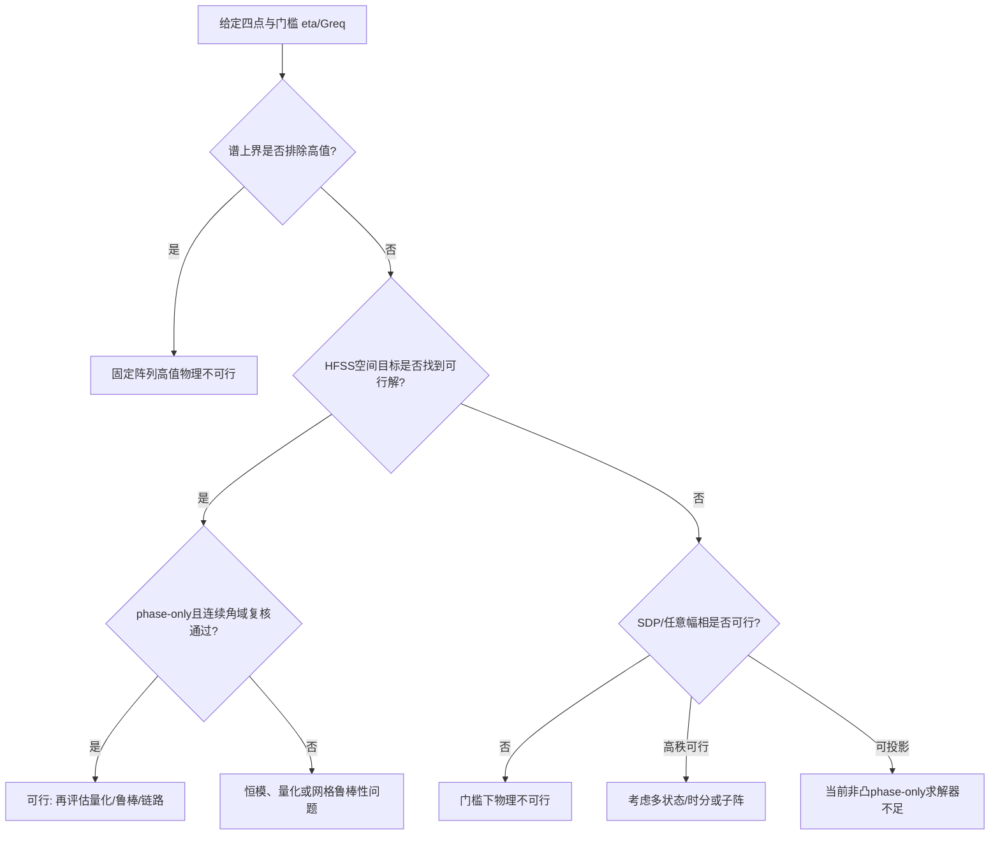

# 四点优化不理想的原因分析

## 1. 总判断

当前证据不支持用单一原因解释四点结果。更准确的分解是：

\[
\text{四点不理想}
=\text{指标/目标错配}
+\text{多方向物理相容性}
+\text{恒模与非凸搜索差距}
+\text{离散数据和任务定义限制}.
\]

CNN已经从本轮计算链路中完全移除，因此不属于本轮结果的误差来源。

## 2. 各假设、证据和结论强度

|假设|当前证据|判断|仍需什么实验|
|---|---|---|---|
|CNN预测误差导致四点失败|本轮不加载CNN；目标和全场均为HFSS真值|已排除为本轮原因|以后比较CNN权值与本HFSS基线|
|旧target-only目标不正确|H3新增23/600个空间−3 dB成功组，目标损失≤1 dB|明确成立|加入目标邻域和连续角域约束|
|旧求解预算太小|旧O0/O3很接近；新高预算相对低预算主要改善`rho`中位，严格成功率变化很小|存在影响但不是主因|对96个未决组做更全局搜索|
|纯压峰即可解决|H1空间成功增加，但最小增益P5从1.15降至−1.77 dB，严格成功反降|否|必须加入绝对或相对单点下限|
|phase-only恒模造成全部失败|489组即使允许任意复幅也被证明无法达到`u>=0.5`|不能解释这489组|对未决组比较SDP、任意幅相和phase-only|
|固定阵列四方向响应不相容|81.5%谱上界证书；分离/掠射组约97%–99%被排除|强证据支持|多频/多状态HFSS及阵列结构对照|
|四点位置无关|严格成功全部聚集；距离/离轴角与`rho`显著负相关|已否定|用Gram矩阵替代仅靠角距的分析|
|当前结果可代表真实轨道|四点为随机分层样本，任务合同缺少真实轨道|不能成立|输入真实轨道、姿态与四站坐标|
|1°网格等于连续半球|峰值只在离散网格搜索|不能成立|峰值邻域自适应加密或连续界|

## 3. 目标函数错配：已经证实但只能解释一部分

H0最大化四个目标中的最小值：

\[
\max_w\min_iG_i(w).
\]

它不关心正半球其他方向是否出现更高峰值。因此H0可以提高四点绝对值，却让四点相对整个方向图
仍处于−10 dB甚至更低位置。H3增加正半球峰值控制后：

- 空间 `rho>=0.5` 从17/600变为40/600；
- 新增23组，未丢失旧成功组；
- 配对提升为3.83个百分点，95%区间 `[2.33,5.50]`；
- `rho`中位数从0.124提高到0.171。

所以“旧目标没有直接优化四强点”是确定原因。但H3仍有560/600组达不到空间−3 dB，而且目标最小
增益中位数从4.50降至3.65 dB，说明改目标只能找回一部分可行性。

## 4. 为什么空间强不等于真正高值

H1只最大化 `rho`，结果为：

- 空间−3 dB成功率从2.83%提高到5.50%；
- 最小增益P5从1.15 dB降到−1.77 dB；
- `u>=0.5`从7.33%降到0.50%；
- 严格四强从0.33%降到0.17%。

这说明优化器可以通过压低非目标峰值、改变正反半球能量分配或牺牲目标绝对增益改善比例。即使应用
只关注正半球，也不能允许算法靠把正半球整体变弱来取得高 `rho`。因此最终问题至少要包含

\[
\rho\ge\eta,\qquad G_{\min}\ge G_{req}.
\]

当前没有 `G_req`，只能暂用 `u`和相对H0损失约束。

## 5. 固定阵列多方向相容性：最强证据

谱上界P5/中位/P95为0.306/0.375/0.688；81.5%的样本上界低于0.5。这意味着489组即使使用
任意复幅权值，也无法让四点同时达到各自单点上限−3 dB。

按位置分层：

|类型|被证明 `u<0.5` 的比例|H3 `rho`中位|H3严格成功|
|---|---:|---:|---:|
|聚集|32.00%|0.27|2.67%|
|掠射|96.67%|0.13|0%|
|中等|98.67%|0.17|0%|
|宽分离|98.67%|0.16|0%|

H2得到的5个严格成功样本全部为聚集点，平均点间角距中位数4.47°、最大点间角距中位数6.06°。
这更像一个主瓣覆盖四个近邻方向。对于真正分离的四点，当前固定阵列没有显示出四个独立高值波束
同时存在的能力。

需要注意：理想情况下四个正交波束平均分配功率本身约有6 dB分配代价，但如果四束完全平衡，空间
`rho`仍可能很高。当前结果同时出现低`u`和低`rho`，说明除基本功率分配外，还存在恒模投影、
非目标峰值和真实HFSS方向响应不相容。

## 6. 四点坐标如何影响结果

H3的 `rho` 与以下特征的Spearman相关系数为：

|坐标特征|相关系数|
|---|---:|
|最小点间角距|−0.271|
|平均点间角距|−0.391|
|最大点间角距|−0.362|
|平均离轴角|−0.374|
|最远目标到实际半球峰值角距|−0.558|

含义如下：

- 四点越分散，越难由同一个16维恒模向量同时匹配；
- 四点越靠近半球边缘，单元方向图、有效孔径和极化投影通常越不利；
- 最远目标到实际峰值的距离比单纯点间距更能描述失败，因为它同时反映目标不平衡和非目标峰值；
- 相同球面角距但整体旋转到不同方位时，真实阵列几何、单元方向图和极化不对称会产生不同结果。

下一步坐标分析不应只用角距，应计算归一化 `Q_i` 之间的Frobenius相似度、主特征向量相干性、
四目标Gram矩阵特征值和条件数。

## 7. 非凸求解和恒模限制：仍未完全排除

高预算搜索使用12起点、6轮峰值挖掘和每轮300步。相比早期4起点、3轮、120步版本：

- H3验证集 `rho`中位数由约0.148提高到约0.175；
- 空间−3 dB成功率只从6.67%提高到7.08%；
- 严格成功率仍为0.83%。

因此增加预算能改善连续指标，但没有改变严格成功率的数量级。不过“高预算数值搜索”仍不是全局
证明，不能把全部剩余失败归因于物理。

在600组留出样本中，111组没有被谱上界排除。其中：

- 4组由H3实现严格四强；
- 11组只有牺牲超过1 dB目标增益才能实现空间四强；
- 96组保持未决。

对这96组，建议依次比较：

1. 带正半球切平面的SDP松弛；
2. SDP最优矩阵的秩和随机化/相位投影；
3. 任意幅相单状态局部优化；
4. phase-only更全局搜索；
5. 多状态平均功率或时分波束。

只有SDP也不可行时，才能对对应门槛给出更强的物理不可行结论。SDP高秩可行意味着平均协方差
可能可行，但不等于单个phase-only状态可行。

## 8. 建议讨论时采用的判别树

## 9. 最值得共同讨论的开放问题

1. “四强点”门槛应取−10、−7还是−3 dB？是否还必须满足绝对 `G_req`？
2. 四个近邻点由一个宽主瓣覆盖，是否算业务上的“四点波束”？
3. 每个目标应是一个坐标点，还是含轨道/指向误差的角域邻域？
4. 是否必须单一瞬时权值，还是允许时分、多码字或子阵划分？
5. 相位分辨率、通道幅相误差和功放限制是多少？
6. 若固定阵列严格四强不可行，下一步优先放宽门槛、调度服务，还是修改阵列结构？
7. 真实轨道中四点分布更接近clustered、moderate、wide还是grazing，各类概率是多少？

这些问题的答案会改变“优化不理想”的定义，必须在继续比较算法前固定。
