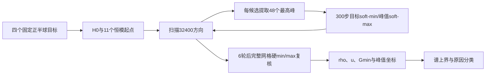

# 纯 HFSS 四点优化方法说明

## 1. 研究问题

本实验只回答固定阵列和固定HFSS电磁状态下的三个问题：

1. 给定正半球四个方向，能否找到一个恒模相位权值，使四点都位于该次正半球方向图的强区？
2. 达到空间强区时，四点是否仍保留足够高的单点能力，而不是通过整体降低目标增益实现？
3. 失败来自旧目标函数、非凸搜索、phase-only约束，还是阵列在四个位置上的远场响应本量本身不相容？

实验不是CNN评估，也不是轨道、链路或FPGA验收。

## 2. 控制变量

|变量|固定值|
|---|---|
|阵列|4×4，16端口，结构与端口顺序不变|
|频率|47 GHz|
|电磁数据|同一个HFSS求解状态的16端口嵌入式复远场|
|空间范围|仅 `q_x>0` 正向半球|
|权值|单状态phase-only，`|w_n|=1/4`，所以 `||w||_2=1`|
|四点坐标|验证/留出四点集合固定，不允许优化坐标|
|模型|不加载CNN，不产生CNN预测|
|最终峰值复核|完整32,400方向HFSS正半球网格|

改变的变量只有四点优化目标。验证集240组用于确认方法行为；随后冻结预算，在600组留出集运行。

## 3. HFSS远场表示与增益

每个方向 `q` 保存复数HFSS因子

\[
H(q)\in\mathbb C^{3\times16}.
\]

给定16端口复权值 `w`，远场线性叠加为

\[
E(q,w)=H(q)w.
\]

本实验使用的总增益功率为

\[
G(q,w)=\frac{\lVert H(q)w\rVert_2^2}{60}.
\]

一般公式还应除以 `||w||²`；本实验恒有 `||w||²=16(1/4)²=1`，所以代码中不再重复相除。
二次型写法为

\[
Q(q)=\frac{H(q)^HH(q)}{60},\qquad G(q,w)=w^HQ(q)w.
\]

这里的 `H`、`Q` 和最终增益均来自HFSS数据，不由神经网络生成。

## 4. 正半球网格

训练、验证、校准和留出四个方向分块仅在数据管理上互斥；本实验把四块HFSS方向合并，用作精确
方向图约束网格：

- 32,400个唯一正半球方向；
- 约1°角度采样；
- 所有方向满足 `q_x>0`；
- 反半球方向使用数为0。

这是“已知HFSS状态下的oracle数值基线”，因此允许优化器查询完整HFSS网格。它不代表部署时能够
从四个坐标直接获知新物理状态的完整方向图。

## 5. 四点集合

四点集合由固定随机种子生成，验证集240组、留出集600组，每类分别为60组和150组：

|类型|坐标条件|
|---|---|
|clustered|任意两点的最大球面角距不超过15°|
|moderate|任意两点的最小球面角距不小于15°|
|wide|任意两点的最小球面角距不小于45°|
|grazing|四点均满足 `q_x<0.25`，且最小点间角距不小于12°|

每组四点互不重复，且所有点位于正向半球。该分层用于覆盖近邻、多方向分离和半球边缘压力情况，
并不代表真实轨道概率分布。这些是生成器的接受条件而非严格互斥的几何区间，例如moderate条件
本身没有额外排除最小角距超过45°的组合；统计时以生成时写入的stratum标签为准。

## 6. 三类评价量

### 6.1 目标最小增益

\[
G_{\min}(w)=\min_{i=1,\ldots,4}G(q_i,w).
\]

它衡量四点中最差点的绝对HFSS增益，但在缺少链路合同的情况下不能判断业务是否成功。

### 6.2 同一次方向图的空间强度

\[
P_H(w)=\max_{q\in H^+}G(q,w),\qquad
\rho(w)=\frac{G_{\min}(w)}{P_H(w)}.
\]

`rho=0.5/0.2/0.1`分别对应四点全部位于本次正半球峰值以下3.01/6.99/10.00 dB以内。

### 6.3 相对各自单点能力的利用率

先对每个目标单独进行phase-only数值优化，得到 `G_i^solo`，再定义

\[
u(w)=\min_i\frac{G(q_i,w)}{G_i^{solo}}.
\]

`u`衡量四点共享一个权值所付出的多方向相容性代价。单点上限本身是数值结果而非解析全局最优；
若它被低估，会让 `u`和后面的谱上界更宽松，不会制造虚假的“不可能”证明。

本实验把

\[
\rho\ge0.5\quad\text{且}\quad u\ge0.5
\]

称为严格“四强且高值”。最终工程应把 `u`替换或补充为真实 `G_min>=G_req`。

## 7. H0：旧目标控制组

H0直接使用已有真实HFSS O3高预算权值。它优化

\[
\max_{|w_n|=1/4}\min_i 10\log_{10}G(q_i,w).
\]

数值上采用退火soft-min代理：

\[
L_T(w)=T\log\sum_i\exp[-G_{i,\mathrm{dB}}(w)/T],
\]

温度由1.2下降到0.12。O3使用32个起点、320步Adam、学习率0.065；起点来自目标 `Q_i`
的主特征向量、加权组合特征向量及已有候选，再投影到恒模相位。

O3只是高预算可行数值参考，不是全局最优证明。此前O0与O3的目标增益及空间 `rho`非常接近，
说明在旧目标内单纯增加预算已经很难改变结果，但不能由此推导新空间目标也不可行。

## 8. H1–H3：正半球峰值主动集优化

三种新方法都优化目标最小增益与正半球峰值之间的dB间隔：

\[
m(w)=G_{\min,\mathrm{dB}}(w)-P_{H,\mathrm{dB}}(w)
=10\log_{10}\rho(w).
\]

- H1：直接最大化 `m(w)`，不限制相对H0的目标增益损失；
- H2：增加 `G_min,dB(w)>=G_min,dB(H0)-0.5 dB`；
- H3：增加 `G_min,dB(w)>=G_min,dB(H0)-1.0 dB`。

H2/H3不是统一减去常数，而是逐个四点样本相对各自H0结果设置下限。

### 8.1 起点

每个四点样本使用12个恒模起点：

- H0权值；
- 四个目标 `Q_i`等权组合的主特征向量再恒模投影；
- 多组随机凸组合 `sum alpha_i Q_i` 的主特征向量再恒模投影；
- 对H0相位施加不同幅度的随机扰动后重新投影。

所有方法使用固定随机种子；方法之间只改变增益保持门槛。

### 8.2 峰值切平面/主动集

直接在每一步对32,400方向反向传播代价较高，因此采用下列循环：

1. 用当前12个候选权值扫描完整正半球；
2. 对每个候选保留增益最高的48个HFSS方向；
3. 在四个目标方向与这些活跃峰值方向上优化300步；
4. 回到完整32,400方向重新扫描，发现新的峰值；
5. 共执行6轮，并保存所有轮次中通过增益保持约束且真实 `m(w)` 最大的候选。

内部用退火soft-min近似目标最差点、用soft-max近似活跃半球峰值；每轮结束后的候选选择和最终指标
均使用硬 `min/max` 与完整HFSS网格，不使用soft近似作为报告值。H2/H3在梯度阶段用二次罚项
推动候选满足目标下限，最终只允许通过0.5/1.0 dB硬下限的候选参与最优候选选择。

## 9. 谱上界：如何证明一部分组合物理不可能

令

\[
B_i=Q(q_i)/G_i^{solo}.
\]

对任意非负且和为1的 `alpha_i`，任意单位范数复权值 `w` 都满足

\[
\min_i w^HB_iw
\le w^H\left(\sum_i\alpha_iB_i\right)w
\le\lambda_{\max}\left(\sum_i\alpha_iB_i\right).
\]

因此

\[
u^*\le
\min_{\alpha\in\Delta_4}
\lambda_{\max}\left(\sum_i\alpha_iB_i\right).
\]

实验用softmax参数化 `alpha`并用BFGS最小化右侧。这个上界：

- 去掉了phase-only恒模限制，允许任意复幅权值；
- 若上界低于0.5，可严格排除原phase-only问题达到 `u>=0.5`；
- 若上界高于0.5，只能说“未被排除”，不能证明存在可实现权值；
- 它约束的是相对单点高值 `u`，不是单独的空间比例 `rho`。

## 10. 统计与原因分类

所有方法在相同四点组上成对比较。成功率差异使用2,000次成对bootstrap重采样给出95%区间。

原因分析采用两条互补轴：

1. 空间目标轴：新方法是否在规定目标损失内把原失败组变为 `rho>=0.5`；
2. 高值可行性轴：谱上界是否已经排除 `u>=0.5`。

对未被谱上界排除、且现有phase-only搜索仍失败的样本，统一标记为未决，不把它们提前归入物理不可行。
