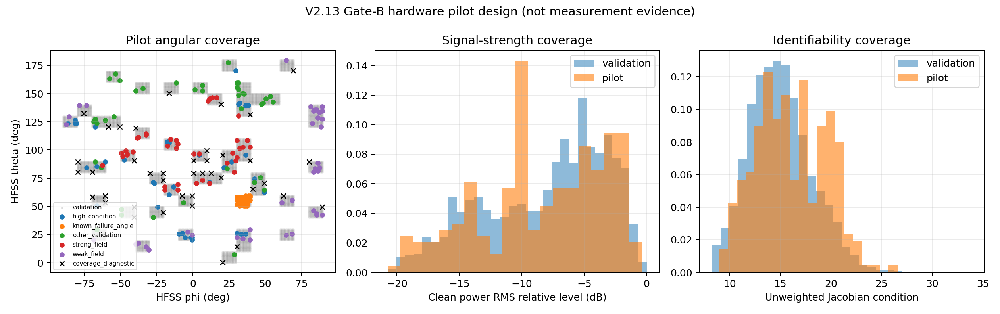

# AESA-CNN V2.13-Validation

## 版本摘要

| 项目 | 内容 |
|---|---|
| 类型 | V2.12 物理闭环与测量可辨识性审计版，不训练新模型 |
| 继承 | 完整冻结 V2.12 模型、数据划分和幅度合同 |
| 主要变化 | 增加 HFSS Gate A、噪声敏感性、硬件 Gate B 测量合同和结构压力演练 |
| 冻结结论 | Gate A 通过；真实独立功率重复缺失，Gate B 为 `ideal-synthetic-only / hardware-blocked` |
| 后续关系 | V2.14 把结构和覆盖假设移入独立 validation-only 实验区 |

V2.13 不是新模型版本，而是对 V2.12 amplitude-only rank-1 operator 模型的
物理闭环审计。它不修改 V2.10、V2.11 或 V2.12，也不重新训练模型。

核心审计链为：

\[
E_{\rm HFSS}(q,w)\overset{?}{=}g^T(q)w
\rightarrow Q_{\rm truth}=g^*g^T
\rightarrow \widehat Q_{\rm amp}
\rightarrow \widehat Q_{\rm CNN}(q)
\rightarrow \widehat w
\rightarrow Q_{\rm truth}.
\]

- 冻结验证方案：[V2.13_VALIDATION_PLAN.md](V2.13_VALIDATION_PLAN.md)
- 首轮结果与下一步：[V2.13_INITIAL_PHYSICS_CLOSURE_RESULTS_20260912.md](V2.13_INITIAL_PHYSICS_CLOSURE_RESULTS_20260912.md)
- Gate-B 噪声审计结果：[V2.13_GATE_B_NOISE_AUDIT_RESULTS_20260912.md](V2.13_GATE_B_NOISE_AUDIT_RESULTS_20260912.md)
- 冻结 CNN 结构与压力演练：[V2.13_CNN_STRUCTURE_STRESS_RESULTS_20260913.md](V2.13_CNN_STRUCTURE_STRESS_RESULTS_20260913.md)
- 阶段性判断与操作自检：[V2.13_SELF_CHECK_20260913.md](V2.13_SELF_CHECK_20260913.md)
- Gate-B 实测导入合同：[measurement_contract/GATE_B_MEASUREMENT_CONTRACT.md](measurement_contract/GATE_B_MEASUREMENT_CONTRACT.md)
- 机器可读结果：[artifacts/physics_closure_seed21201_20260912.json](artifacts/physics_closure_seed21201_20260912.json)
- Gate-B 机器可读结果：[artifacts/gate_b_noise_audit_20260912/GATE_B_SYNTHETIC_NOISE_AUDIT.json](artifacts/gate_b_noise_audit_20260912/GATE_B_SYNTHETIC_NOISE_AUDIT.json)
- Gate-B 硬件 pilot 统计设计：[artifacts/gate_b_hardware_pilot_20260913/PILOT_STATISTICAL_DESIGN.md](artifacts/gate_b_hardware_pilot_20260913/PILOT_STATISTICAL_DESIGN.md)
- Gate-B pilot 方向与采集调度：[artifacts/gate_b_hardware_pilot_20260913/](artifacts/gate_b_hardware_pilot_20260913/)
- Gate-A HFSS 自动导出说明：[hfss_gate_a/README.md](hfss_gate_a/README.md)
- Gate-A 导出结果：[HFSS_GATE_A_EXPORT_20260912.md](HFSS_GATE_A_EXPORT_20260912.md)



该图用于说明拟采集方向是否覆盖角域、信号强度和可辨识性条件；它是采样设计，不是硬件测量证据。

快速验收：

```powershell
python algorithm_versions/v2.13/tools/run_tests.py
```

## Gate-B 精简记录（2026-09-12）

- 全仓库未发现真实、非相同的独立功率重复；现有三次 repeat 为同一 `g` 生成的
  bit-identical synthetic 副本。因此 Gate B 为 **ideal-synthetic-only / hardware-blocked**。
- 噪声基线使用全部 4900 个 validation directions；64 条 train commands 恢复 `Q`，
  16 条 validation commands 回放；每场景 5 个 synthetic repeats、400 步冻结反演。
- 三类功率噪声的聚合结果范围如下；这些数字只用于测量设计，不是硬件验收结果。

| SNR | operator NMSE 范围 | held-out power NMSE 范围 |
|---:|---:|---:|
| 20 dB | -24.138 至 -23.230 dB | -27.012 至 -26.136 dB |
| 30 dB | -34.218 至 -33.445 dB | -37.007 至 -36.232 dB |
| 40 dB | -44.080 至 -43.480 dB | -46.931 至 -46.176 dB |

未加权 Jacobian condition 的 median 为 `14.75–14.83`、P95 为 `20.32–20.45`。
20 dB 加性噪声的主要长尾位于 `theta=50–60°、phi=30–40°`：该 10° 角格的
operator NMSE P95 为 `-4.80 dB`，但全 validation 中差于 `-10 dB` 的方向占 `0.18%`。
真实测量硬下限为 3 次独立重复，首轮正式硬件审计建议至少 10 次并覆盖两个独立会话。

## 下一步采集已就绪（2026-09-13）

已冻结 240 个 validation-only pilot 方向：200 个分层随机方向用于带权总体统计，另有
40 个空间覆盖方向只用于诊断。全 validation 到最近 pilot 的角距离 P95 为 `4.05°`，
最大为 `5.37°`。R=10 的完整计划包含 `192000` 条功率观测，拆为两个各 5 次的
session block；30 dB repeat SNR 假设下，均值功率的理论 95% CI 半宽约 `±2.26%`。
方向、80 条命令、随机化调度和导入 manifest 模板均已生成，但在真实功率结果回填前，
Gate B 仍不改变为 hardware pass。

## CNN 结构演练精简记录（2026-09-13）

对冻结 V2.12-S 候选及等参数 matched-Fourier 对照完成十种子 validation-only 审计。
候选基线 `-24.156±0.418 dB`，平均领先 `0.640 dB`；但方向元数据偏差从 0 增至
0.5°/1°/2° 时，候选退化至 `-20.882/-17.210/-12.514 dB`，2° 时对照优势的
95% CI 已跨零。因子拆分确认大部分敏感性来自解析阵列传播相位，不应通过平滑 CNN 消除。

结构上，Fourier-CNN 占 `96.03%` 参数，而 SSH 仅占 `3.86%`；移除两者分别导致
`+12.058/+16.942 dB` 退化，且 SSH `l=1` 最关键。逐方向误差与最近训练角距离的
Spearman 相关为 `0.638`，明显强于分支能量指标，但这不是因果证明。因此下一结构实验优先验证角域覆盖、
加入去相位包络抖动约束，并测试小型 SSH/Fourier fusion 与等参数容量重分配，不直接扩大网络。
该演练没有训练、没有使用 external test，也不改变 Gate B hardware-blocked 状态。

后续结构筛选已移入独立 [V2.14 实验区](../v2.14/README.md)，不修改本版本。V2.14
Stage-0 的当前 1×1 cross-branch fusion 与 envelope jitter 均未达到扩展阈值，已停止该具体路线。

当前结论：Gate A 已在 HFSS 线性 source/report 路径上通过；Gate C 的结构合同成立；Gate B 没有真实非相同重复，硬件状态仍 blocked；
现已补充 20/30/40 dB 加性、乘性和混合功率噪声的 ideal-synthetic-only 敏感性基线，
它只用于测量设计和失效边界；
Gate D 给出去相位后局部粗糙度下降的证据，但不支持“包络必然由更低阶 SSH
表示”的强结论；Gate E 仅完成 validation 数值诊断。由于缺少独立组合端口 HFSS
复场的问题已经解除，但真实重复噪声下的 amplitude-only 可辨识性仍未关闭，因此整个
硬件物理闭环尚未通过。

external test 保持封存。
