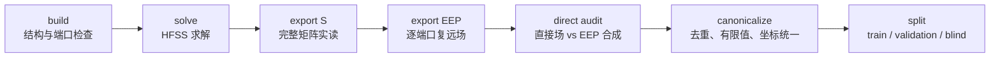

# AESA-CNN V2.12 与 V2.16 算法结构、HFSS 验证方案及结果完整汇报

> 汇报材料版本：2026-10-15  
> 适用对象：了解基本人工智能概念，但不一定熟悉深度学习工程、电磁场仿真或阵列天线的读者  
> 结论口径：以仓库中已经保存的代码、预注册方案、机器回执和结果文档为准；明确区分“算法预测结果”“HFSS 数据一致性验证”和“真实硬件验证”

---

## 0. 最重要的结论先讲清楚

本项目要解决的并不是一般意义上的“输入一张图、输出另一张图”，而是一个带有明确物理结构的阵列天线正向预测问题：给定观察方向和 16 个阵元的复数激励，预测该方向上的复电场以及最终幅度。

V2.12 建立了项目后续版本共用的核心骨架：

1. 用解析公式计算阵元位置带来的传播相位；
2. 用逐阵元复数基准和 filtration SSH 表达较平缓、较低复杂度的方向变化；
3. 用小型二维残差 CNN 学习解析模型没有解释完的复数包络残差；
4. 最后严格执行复数相干叠加，再取绝对值得到幅度。

因此，V2.12 不是让 CNN 从零“猜”方向图，而是让物理模型负责确定性部分，让神经网络只学习剩余修正。这是整个算法最关键的设计思想。

V2.16 没有推翻这套物理骨架。它只把 V2.12 两个残差块内部的普通 `3×3` 卷积，替换为分别沿阵列行方向和列方向传播的 DCAR（Direction-Conditioned Axial Residual，方向条件化轴向残差）结构，并用观察方向产生每个残差块的行、列门控系数。

当前结论必须分成两个层次：

| 结论范围 | 当前判断 |
|---|---|
| V2.16 原始数据与原始 validation/coverage 协议 | `dcar_gated_pm` 相对 V2.12 control 平均提高约 1 dB，三种子均为正向；这是一次通过预注册探索门槛的受控结构实验 |
| 新 canonical 4×4 数据协议上的迁移复核 | V2.16 的优势没有稳定复现；2026-10-15 的 V2.18 结论是 `ENGINEERING_CANDIDATE_NONE`，当前 canonical 4×4 基线仍选 V2.12 control |
| HFSS 数据完整性 | 1×4、2×4、4×4、1×8 四种阵列的数据门禁均已通过；每种 canonical 数据均有 64,441 个有限、无重复的前半球方向 |
| 跨阵列模型普适性 | 只得到 `PARTIAL_2_OF_4`：1×8、2×4 通过，1×4、4×4 未通过；不能宣称结构对所有阵列普适 |
| 真实硬件闭环 | 尚未完成。Gate B 缺少真实、非完全相同的重复功率测量，状态仍是 `hardware-blocked` |
| blind test | 仍封存，没有被用于结构、阈值、归一化或模型选择 |

一句话总结是：

> **V2.12 建立了可靠、可解释的物理—神经网络混合基线；V2.16 在原协议内证明“保持深度和容量后，方向门控的行列分解有探索价值”，但这一优势尚未在新的 canonical 4×4 协议上稳定迁移，因此目前不能把 V2.16 宣布为已经全面取代 V2.12 的最终模型。**

---

## 1. 问题到底是什么

### 1.1 输入和输出

以 4×4 阵列为例，共有 16 个阵元。一次预测需要两类输入：

- 观察方向 \(q=(q_x,q_y,q_z)\)，它是一个三维单位向量；
- 16 个阵元的复数激励 \(w\in\mathbb C^{16}\)，每个复数同时包含幅度和相位。

模型首先预测该方向上 16 个端口对应的复响应：

\[
g(q)=[g_1(q),\ldots,g_{16}(q)]\in\mathbb C^{16}.
\]

然后按照阵列的线性叠加规律计算总复场：

\[
E(q,w)=\sum_{n=1}^{16}g_n(q)w_n=g(q)^T w.
\]

最终幅度为：

\[
\hat y(q,w)=|E(q,w)|.
\]

这里最重要的一点是：网络并不直接针对某一条命令输出一个幅度。它先预测一个可以重复使用的逐阵元复算子 \(g(q)\)，之后任何命令 \(w\) 都能通过解析相干叠加得到结果。这使模型不仅能画方向图，也能服务于后续波束权重优化。

### 1.2 为什么必须预测复数，而不能只预测幅度

阵列天线的增益来自相干叠加。同样的 16 个阵元幅度，如果相位关系不同，可能形成主瓣，也可能互相抵消形成深零陷。因此只拟合最终幅度会隐藏阵元之间最关键的相位关系。

本项目使用 I/Q 两个实通道表示一个复数：

\[
z=I+jQ.
\]

网络输出的 2 个通道不是“两种功率”，而是复数残差的实部和虚部。

### 1.3 可辨识的物理对象：\(Q\) 矩阵

只有幅度或功率观测时，\(g(q)\) 可以整体乘上任意公共相位而不改变结果。也就是说，单看幅度不能唯一确定 \(g\) 的绝对相位。真正能由 amplitude-only 数据确定的是：

\[
Q(q)=g(q)^*g(q)^T,
\]

并且：

\[
|g(q)^Tw|^2=w^H Q(q)w.
\]

这个 \(Q\) 天然是 Hermitian、半正定并且 rank-1。项目因此采用两套互补指标：

- \(g\) 或去相位包络用于理解网络内部学到了什么；
- \(Q\) 用于提出 amplitude-only 数据真正支持的物理结论。

这也是为什么报告中会同时出现 amplitude NMSE、complex operator NMSE 和 Q NMSE：三者观察的是不同层面的误差，不能互相替代。

### 1.4 完整正向计算流程

```mermaid
flowchart LR
    Q[观察方向 q] --> F[Fourier-27 方向编码]
    Q --> S[filtration SSH]
    Q --> P[解析传播相位]
    G[4 张阵列几何图] --> R[残差 CNN 或 DCAR]
    F --> R
    B[逐阵元复基准] --> A[复包络 a(q)]
    S --> A
    R -->|复残差 delta| A
    A --> O[逐阵元复算子 g(q)]
    P --> O
    W[16 阵元复激励 w] --> C[复数相干求和]
    O --> C
    C --> M[幅度预测 abs(g^T w)]
```

图中只有“残差 CNN 或 DCAR”负责学习局部复杂修正；解析相位、相干求和和取模仍按明确公式执行。

---

## 2. V2.12 的完整设计思路

## 2.1 总体结构：先写入物理，再学习残差

V2.12 将第 \(n\) 个阵元的复响应写成：

\[
g_n(q)=a_n(q)e^{jkq^Tr_n},
\]

其中：

- \(r_n\) 是第 \(n\) 个阵元的位置；
- \(k=2\pi/\lambda\) 是 47 GHz 对应的波数；
- \(e^{jkq^Tr_n}\) 是由几何位置直接决定的解析传播相位；
- \(a_n(q)\) 是去掉名义传播相位后的复包络。

包络进一步写成：

\[
a_n(q)=s\left[
b_n+
\sum_{l=1}^{4}\alpha_l
\sum_{\mu=1}^{2l+1}\phi_{l\mu}(q)\beta_{l\mu n}
+\delta_n(q)
\right].
\]

可以把它理解成三层修正：

1. \(b_n\)：每个阵元的基础复增益；
2. SSH 分支：表达随方向较平缓变化的结构化成分；
3. CNN 残差 \(\delta_n(q)\)：补充前两部分没有表达好的细节。

固定尺度 \(s\) 只由训练方向上的单端口响应估计，解决真实 HFSS 包络并不位于单位尺度附近的问题。它不引入方向相关自由度，也不读取 validation 或 test。

### 通俗理解

可以把 V2.12 看成“物理底稿 + AI 修图”：

- 传播相位是确定的几何透视，直接由公式绘制；
- 基准增益和 SSH 是大轮廓；
- CNN 只处理剩余的局部纹理和复杂误差。

这比让一个大网络完全从头学习物理规律更节省参数，也更容易检查模型到底在做什么。

## 2.2 方向编码：为什么是 Fourier-27

原始方向只有 \((q_x,q_y,q_z)\) 三个数。若直接把它们送入小网络，网络较难表达快速变化的角域结构。V2.12 使用四个确定性频带：

\[
\Gamma(q)=\left[
q_x,q_y,q_z,
\{\sin(2^b\pi q_d),\cos(2^b\pi q_d)\}_{d\in\{x,y,z\},b=0}^{3}
\right].
\]

每个坐标包含原值、4 个正弦和 4 个余弦，共 9 个特征；三个坐标合计：

\[
3\times(1+2\times4)=27
\]

个方向特征。

这 27 个特征会被复制到 4×4 阵元平面上的每个位置。它们不是 27 张自然图像，而是 27 张“所有阵元都能看到的方向条件图”。

## 2.3 四张几何图

V2.12 还为每个阵元位置加入四张固定几何图：

1. row coordinate：阵元所在行的归一化坐标；
2. column coordinate：阵元所在列的归一化坐标；
3. edge indicator：是否位于阵列边缘；
4. corner indicator：是否位于阵列角点。

所以 CNN 的总输入通道数为：

\[
27+4=31.
\]

最终输入张量是 `[B×Q, 31, 4, 4]`。这里的 4×4 不是图片像素，而是真实阵列孔径的 4 行、4 列阵元。

## 2.4 filtration SSH 分支的作用

SSH 在本项目中可以理解为适合半球方向域的结构化基函数。V2.12 使用 \(L=4\)；各阶 filtration rank 为：

\[
(1,3,5,7,9),
\]

合计 25 个模式。常数模式由逐阵元基准 \(b_n\) 承担，因此实际使用 24 个非恒定 SSH 模式。

SSH 分支的作用不是替代 CNN，而是给模型一个较低复杂度、相对慢变的方向坐标。项目最终支持的结论是：

> SSH 是一种低复杂度、相对慢变、优化友好的结构化方向表示；它与 Fourier residual 协同工作时，比单纯增加等量 Fourier 参数更有效。

但项目没有证明 SSH 等于唯一真实的“低频物理场”。这一区别非常重要。

## 2.5 V2.12 CNN 的逐层结构

V2.12 的 `depth=2` 指有两个 residual block，不是整个网络只有两层。若按带空间卷积的模块统计，最长前向路径共有 6 次 `3×3` 卷积。

| 顺序 | 层或操作 | 张量形状 | 作用 | 参数量 |
|---:|---|---|---|---:|
| 0 | 固定 Fourier 编码 | `[B,Q,3] → [B,Q,27]` | 把方向映射到多频坐标 | 0 |
| 1 | 拼接四张几何图 | `[B,Q,27] → [BQ,31,4,4]` | 告诉网络阵元在孔径中的位置 | 0 |
| 2 | stem `Conv2d(31,24,3×3)` | `[BQ,31,4,4] → [BQ,24,4,4]` | 将输入特征嵌入 24 通道 | 6,720 |
| 3 | SiLU | 形状不变 | 非线性变换 | 0 |
| 4 | block 1 conv 1 `24→24,3×3` | 形状不变 | 第一次局部空间传播 | 5,208 |
| 5 | SiLU | 形状不变 | 非线性变换 | 0 |
| 6 | block 1 conv 2 `24→24,3×3` | 形状不变 | 形成第一段残差，初始权重为零 | 5,208 |
| 7 | skip add | 形状不变 | 输入与残差相加 | 0 |
| 8 | block 2 conv 1 `24→24,3×3` | 形状不变 | 第二个残差块的局部传播 | 5,208 |
| 9 | SiLU | 形状不变 | 非线性变换 | 0 |
| 10 | block 2 conv 2 `24→24,3×3` | 形状不变 | 形成第二段残差，初始权重为零 | 5,208 |
| 11 | skip add | 形状不变 | 输入与残差相加 | 0 |
| 12 | head `Conv2d(24,2,3×3)` | `[BQ,24,4,4] → [BQ,2,4,4]` | 输出 16 个阵元的 I/Q 残差，初始权重为零 | 434 |
| 13 | 有界 `tanh` | 形状不变 | 将单个 I/Q 分量限制在稳定范围内 | 0 |

CNN 参数量为：

\[
6,720+4\times5,208+434=27,986.
\]

V2.12 还有 803 个共同的物理/SSH 可训练参数：

| 参数组 | 数量 | 作用 |
|---|---:|---|
| 基准复增益 | 31 | 第一个阵元固定虚部并令实部为正，用于消除整体相位规范自由度；其余 15 个阵元各有实部和虚部 |
| SSH 复系数 | 768 | 24 个非恒定模式 × 16 阵元 × 实虚两部分 |
| SSH 阶次 gate | 4 | 控制 \(l=1,2,3,4\) 四个阶次 |
| 合计 | 803 | 不含固定相位、固定 basis、坐标和尺度 buffer |

所以总参数量为：

\[
27,986+803=\boxed{28,789}.
\]

## 2.6 为什么使用残差连接和 zero-start

每个 residual block 的第二个卷积被初始化为全零，最终 I/Q head 也初始化为全零。模型刚开始训练时：

\[
\delta_n(q)=0.
\]

因此初始输出严格等于“逐阵元基准 + SSH + 解析相位”的物理基线，而不会被随机 CNN 立刻破坏。训练的含义由“从随机映射里摸索全部规律”变为“从可解释基线出发逐步增加必要修正”。

## 2.7 V2.12 的训练与数据隔离

原始 4×4 协议主要使用：

- 22,600 个训练方向；
- 4,900 个 validation 方向；
- 64 条训练命令；
- 16 条 validation 命令；
- 16 条 external-test 命令保持隔离。

模型选择只允许使用 validation。external test 不能用于选择结构、调整阈值、归一化、决定训练轮数或挑选 checkpoint。

V2.12 的主要训练目标是幅度误差；同时通过结构保证 \(Q\) 的 Hermitian、PSD 和 rank-1 性质。后续审计再分别检查 amplitude、复算子、\(Q\)、梯度方向和波束决策。

## 2.8 V2.12 的主要实验结果

### 第一阶段：rank-1 物理骨架的价值

V2.12 Stage 2 的十种子 validation-D 结果为：

| 模型 | 平均 NMSE | 相对旧幅度基线改善 |
|---|---:|---:|
| G0 / V2.10 amplitude baseline | -17.1431 dB | — |
| Stage 1 E2-F5 | -17.8514 dB | +0.7084 dB |
| G1：Fourier residual + rank-1 physics | -23.7855 dB | +6.6424 dB |
| G2：SSH + Fourier residual + rank-1 physics | -24.1728 dB | +7.0297 dB |

G2 相对 G1 平均提高 0.3873 dB，置信区间为 `[0.0752, 0.7102] dB`，但只有 7/10 种子胜出，没有达到预先冻结的 8/10 门槛。因此当时把 G1 保留为最稳健主模型，把 G2 保留为 SSH 物理候选，而不是事后修改规则宣布 G2 获胜。

更关键的结果是：加入相干 rank-1 物理算子和正确尺度后，性能相对旧幅度基线提高约 6.6–7.0 dB；这说明主要进步来自物理建模方式，而不是单纯堆叠更多网络层。

### 第二阶段：SSH 是否真的有等参数预测价值

V2.12-S 使用严格等参数对照，正式模型均为 29,142 个可训练参数：

| 模型 | 十种子 NMSE 均值 | 主瓣 MAE | 说明 |
|---|---:|---:|---|
| G1-M5 | -23.516 dB | 0.311 dB | 等容量 Fourier 对照 |
| G2-J | -24.100 dB | 0.287 dB | SSH + Fourier 联合模型 |
| G2-J + `lambda_sep=0.001` | **-24.156 dB** | **0.279 dB** | 冻结候选 |

冻结候选相对 G1-M5：

- 平均提高 0.640 dB；
- paired bootstrap 95% CI 为 `[0.358, 0.977] dB`；
- 10/10 种子获胜；
- Holm 校正 `p=0.00390625`。

因此 V2.12 最终形成三级结论：

| 层级 | 问题 | 结论 |
|---|---|---|
| Level 1 | SSH 是否具有不能由等参数 Fourier 解释的预测价值 | `PASS` |
| Level 2 | SSH 与 Fourier 是否形成稳定的慢变—快变 latent 分工 | `PASS` |
| Level 3 | SSH 是否改善 gauge-invariant 物理算子的全局平滑性 | `FAIL` |

所以正确说法是“SSH 是有效的结构化方向坐标”，而不是“SSH 已恢复唯一真实低频物理场”。

### 第三阶段：V2.13 对冻结 V2.12 的物理审计

在一个冻结的 V2.12 候选上，validation-D 得到：

- amplitude NMSE：`-24.664 dB`；
- dB MAE：`0.750 dB`；
- P95 绝对 dB 误差：`2.621 dB`；
- 完整 \(Q\) operator NMSE：`-18.367 dB`；
- power-gradient cosine 均值：`0.9787`，中位数：`0.9959`；
- relative gradient error 均值：`0.1814`，P95：`0.5092`。

幅度误差比完整算子误差好约 6.30 dB，说明有限命令上的幅度拟合会掩盖一部分完整算子错误。今后的模型评价不能只看 amplitude NMSE。

在 64 组四方向 phase-only max-min validation 问题上：

- decision gap 中位数：`0.072 dB`；
- P95：`0.391 dB`；
- relative regret 中位数：`1.64%`；
- P95：`8.61%`。

这些数据说明模型对优化决策有良好迹象，但数值参考不是带全局证书的全局最优解，因此不能称为“达到全局 HFSS oracle”。

---

## 3. V2.16 为什么出现：V2.12 还有什么结构问题

V2.12 的普通 `3×3` 卷积把 4×4 阵列当作规则二维网格处理。这是合理基线，但它没有显式区分：

- 沿行方向传播的信息；
- 沿列方向传播的信息；
- 不同观察方向下，两条轴向传播的重要性如何变化。

对于阵元间位移 \(\Delta r\)，方向变化会改变相位差：

\[
\Delta\varphi(q)=kq^T\Delta r.
\]

若阵列行、列间距不同，或者观察方向沿两个轴变化不同，那么行、列传播不应总被同一个固定 `3×3` 核以同一种方式处理。

V2.16 因此提出 DCAR：把二维传播拆成行分支和列分支，再由观察方向控制每一分支的强度。

需要强调：V2.16 不使用 V2.15 的 S 图分支，也没有自由的 16×16 耦合矩阵。S 参数用于 HFSS 数据和物理审计，但不是 V2.16 CNN 的显式输入。真实互耦的影响主要已经包含在 HFSS EEP 标签和模型需要学习的残差中。

---

## 4. V2.16 Stage-0：一次重要但失败的首版实验

## 4.1 Stage-0 的结构

首版 V2.16 仅保留 27 维 Fourier 方向特征和 row/column 两张坐标图，共 29 通道；使用：

- `1×1` stem；
- 一次并联的 `3×1` 行卷积和 `1×3` 列卷积；
- 可选的两个方向 gate；
- `1×1` zero-start I/Q head。

它与 V2.12 同时存在四项差别：

1. 空间深度减少；
2. 感受野改变；
3. 删除 edge/corner 图；
4. `3×3` 卷积改为轴向卷积。

因此它不是一个只改变“普通卷积 vs 轴向卷积”的干净对照。

## 4.2 Stage-0 结果

| 模型 | validation NMSE / MAE | coverage NMSE / MAE | 复 operator NMSE |
|---|---:|---:|---:|
| V2.12 control | -26.469 / 0.633 dB | -26.590 / 0.619 dB | -20.493 dB |
| axial static | -24.161 / 0.914 dB | -24.422 / 0.895 dB | -18.411 dB |
| axial gated | -24.253 / 0.948 dB | -24.487 / 0.922 dB | -18.690 dB |
| isotropic control | -23.917 / 0.930 dB | -24.199 / 0.904 dB | -18.409 dB |

`axial_gated` 相对 V2.12 control：

- validation 平均退化 2.216 dB，0/3 种子改善；
- coverage 平均退化 2.103 dB，0/3 种子改善；
- 低于 -20 dB 的弱场 validation 平均退化 4.644 dB。

Stage-0 因此被正式停止。这个负结果不能解释成“DCAR 思想错误”，因为实验同时把 V2.12 最长路径上的 6 次空间卷积缩减为 1 次，并删除了两张几何图。

它真正说明的是：**不能为了结构看起来更简洁，就把原有模型的深度、上下文和输入提示一起删掉。**

---

## 5. V2.16 Stage-1：受控 DCAR 的最终实现

## 5.1 控制变量原则

Stage-1 恢复 V2.12 的以下全部设置：

- 27 张 Fourier 方向图 + row/column/edge/corner，共 31 张输入图；
- 主宽度 24；
- `3×3` stem；
- 两个 residual block；
- 每条最长路径、每个 block 两次空间卷积；
- 相同的 SiLU 位置；
- `3×3` I/Q head；
- 第二卷积和 head 的 zero-start；
- \(L=4\) filtration SSH；
- 解析传播相位；
- 复数相干求和；
- 相同数据、训练预算、paired seeds 和 checkpoint 选择规则。

唯一核心改变是 residual block 内部的空间传播。

V2.12 block：

\[
B(H)=H+C_2^{3\times3}\sigma(C_1^{3\times3}H).
\]

V2.16 DCAR block：

\[
B_D(H,q)=H
+\gamma_r(q)R_2^{3\times1}\sigma(R_1^{3\times1}H)
+\gamma_c(q)C_2^{1\times3}\sigma(C_1^{1\times3}H).
\]

其中：

- \(R_1,R_2\) 只沿阵列行方向传播；
- \(C_1,C_2\) 只沿阵列列方向传播；
- \(\gamma_r(q),\gamma_c(q)\in[-1,1]\) 由方向编码经线性层和 `tanh` 得到；
- gate 可以为负，表示某一方向分支可以被抑制或反向补偿，而不是只能做非负加权。

## 5.2 两个 block 为什么能恢复二维交互

单个 DCAR block 的行、列分支是并联的，看起来只形成“十字形”传播。但两个 block 串联后会自然出现：

\[
\gamma_{2,c}\gamma_{1,r}C_2R_1H,
\qquad
\gamma_{2,r}\gamma_{1,c}R_2C_1H,
\]

也就是先沿行传播再沿列传播，以及先沿列传播再沿行传播。这样可以形成二维、对角和多跳交互，同时仍保留“行”和“列”两个可解释分支。

## 5.3 V2.16 gated-PM 的逐层结构

最终主候选为 `dcar_gated_pm`。其主干如下：

| 顺序 | 层或操作 | 形状或配置 | 作用 |
|---:|---|---|---|
| 0 | Fourier-4 编码 | `[B,Q,3] → [B,Q,27]` | 与 V2.12 相同 |
| 1 | 拼接四张几何图 | `[B,Q,27] → [BQ,31,4,4]` | 与 V2.12 相同 |
| 2 | `3×3` stem | `31→24` | 与 V2.12 相同的特征嵌入 |
| 3 | SiLU | 形状不变 | 与 V2.12 相同 |
| 4 | gate 线性层 | `Linear(27,4)` 后 `tanh` | 为两个 block 各产生 row/column 两个 gate |
| 5 | block 1 row 分支 | `24→36→24`，两次 `3×1` | 第一块沿行传播 |
| 6 | block 1 column 分支 | `24→35→24`，两次 `1×3` | 第一块沿列传播 |
| 7 | 两分支门控并与 skip 相加 | gate 1 的两个系数 | 第一段方向条件残差 |
| 8 | block 2 row 分支 | `24→35→24`，两次 `3×1` | 第二块沿行传播 |
| 9 | block 2 column 分支 | `24→36→24`，两次 `1×3` | 第二块沿列传播 |
| 10 | 两分支门控并与 skip 相加 | gate 2 的两个系数 | 第二段方向条件残差 |
| 11 | `3×3` I/Q head | `24→2` | 输出逐阵元复残差，zero-start |
| 12 | 有界 `tanh` | `2*tanh(raw/2)` | 控制残差范围 |

如果按 PyTorch 中实际存在的卷积模块计数，V2.16 gated-PM 有：

- 1 个 stem；
- 2 个 block × 4 个轴向卷积；
- 1 个 head；
- 合计 10 个 `Conv2d` 模块。

但行、列分支是并联的，因此任何一条最长计算路径仍是：

\[
1\text{ 个 stem}+2\times2\text{ 个 block 卷积}+1\text{ 个 head}=6\text{ 次空间卷积},
\]

与 V2.12 的最长路径深度匹配。

## 5.4 为什么分支宽度是 `(36,35)` 和 `(35,36)`

如果两个轴向分支都只用宽度 24，DCAR 会比 V2.12 少约 23% 参数，难以判断精度差异来自结构还是容量。因此参数匹配版本扩大分支内部宽度：

- block 1：row=36，column=35；
- block 2：row=35，column=36。

交替设计使两个 block 合计的行、列容量完全对称，不人为偏向某一物理轴。

| 模型 | 参数量 | 相对 V2.12 control |
|---|---:|---:|
| V2.12 control | 28,789 | 0 |
| DCAR static-native | 21,973 | -23.68% |
| DCAR gated-native | 22,085 | -23.29% |
| DCAR static-PM | 28,643 | -0.507% |
| DCAR gated-PM | 28,755 | **-0.118%** |

`gated-PM` 只比 control 少 34 个参数。其 gate 层共有 `4×(27+1)=112` 个参数；它与 static-PM 的参数差正好是 112。

## 5.5 V2.16 Stage-1 的训练设置

- 训练方向：22,600；训练命令：64；
- validation：4,900 个方向 × 16 条命令；
- coverage probe：4,380 个方向 × 16 条命令；
- paired seeds：21601、21602、21603；
- 训练轮数：240 epochs；
- 优化器：AdamW；
- batch：512；
- 初始学习率：`1e-3`，第 181 epoch 降到 `3e-4`；
- `lambda_separation=0.001`；
- checkpoint 只由 validation linear NMSE 选择；
- coverage 和复 operator 只在全部训练结束后审计；
- external test 全程未读取。

## 5.6 V2.16 Stage-1 的结果

| 模型 | validation NMSE / MAE | coverage NMSE / MAE | 复 Ephi operator NMSE |
|---|---:|---:|---:|
| V2.12 control | -26.469 / 0.633 dB | -26.590 / 0.619 dB | -20.493 dB |
| static-native | -25.610 / 0.725 dB | -25.776 / 0.705 dB | -19.889 dB |
| gated-native | -26.077 / 0.678 dB | -26.241 / 0.663 dB | -20.275 dB |
| static-PM | -26.859 / 0.620 dB | -26.949 / 0.609 dB | -20.788 dB |
| gated-PM | **-27.452 / 0.590 dB** | **-27.601 / 0.575 dB** | **-21.512 dB** |

`gated-PM` 相对 V2.12 control：

- validation：平均 `+0.983 dB`，3/3 正向，95% CI `[+0.432,+1.534] dB`；
- coverage：平均 `+1.011 dB`，3/3 正向，95% CI `[+0.428,+1.595] dB`；
- 复 Ephi operator：平均 `+1.019 dB`，3/3 正向，95% CI `[+0.531,+1.508] dB`；
- 相对 static-PM：平均 `+0.592 dB`，3/3 正向，95% CI `[+0.146,+1.039] dB`。

这组结果支持两件事：

1. 近等容量的轴向分解本身有正向迹象；
2. 在轴向分解之上加入方向 gate，带来了独立且稳定的增益。

### 不同场强区域

`gated-PM` 相对 control 的平均改善为：

| 真值场强 | validation | coverage |
|---|---:|---:|
| -3 至 0 dB | +1.508 dB | +1.463 dB |
| -10 至 -3 dB | +1.072 dB | +1.065 dB |
| -20 至 -10 dB | +0.950 dB | +0.985 dB |
| 低于 -20 dB | +0.401 dB | +0.561 dB |

弱场和深零陷仍是最难的区域。因为真实复场在相干抵消后接近零，阵元复响应中的很小误差都可能造成较大的相对幅度误差。

### 计算代价

- V2.12 control：19.87 μs/方向；
- gated-PM：24.08 μs/方向；
- 当前 CPU 批量实现约慢 21.2%。

所以 V2.16 的优势不是“参数更多”，但也不是免费得到的：轴向分支数量更多，当前实现没有做算子融合，执行开销更高。

## 5.7 Stage-1 当时允许和不允许的结论

当时允许的结论是：

\[
\boxed{
\text{在原 validation/coverage 机制实验中，深度匹配、近等参数的 gated DCAR 优于 V2.12 3×3 residual。}
}
\]

当时不允许的结论包括：

- 不能说已经在新独立 confirmatory test 上确认；
- 不能说已经全面替代 V2.12；
- 不能说对所有阵列尺寸普适；
- 不能用旧 V2.15 external test 为 V2.16 做选择；
- 不能把裸 gate 数值直接解释为唯一物理机制，因为 gate 与卷积权重之间仍有尺度和符号自由度。

---

## 6. V2.12 与 V2.16 的直接对比

| 项目 | V2.12 | V2.16 Stage-1 gated-PM |
|---|---|---|
| 总体思想 | 解析物理骨架 + SSH + Fourier-CNN 复残差 | 完全保留 V2.12 骨架，只替换 residual block 的空间传播 |
| 输入 | Fourier-27 + 4 张几何图，共 31 通道 | 相同 |
| stem/head | `3×3` | 相同 |
| residual block 数 | 2 | 2 |
| 最长空间卷积路径 | 6 次 | 6 次 |
| block 内传播 | 两次普通 `3×3` | 并联两次 `3×1` 行传播与两次 `1×3` 列传播 |
| 方向条件化 | 方向编码作为普通输入 | 除普通输入外，还为每个 block 产生 row/column gate |
| SSH | \(L=4\)，24 个非恒定模式 | 相同 |
| 解析相位与相干求和 | 有 | 相同 |
| 显式 S 图或自由耦合矩阵 | 无 | 无 |
| 总参数 | 28,789 | 28,755 |
| 原协议 validation NMSE | -26.469 dB | -27.452 dB |
| 原协议 coverage NMSE | -26.590 dB | -27.601 dB |
| 原协议 CPU 延迟 | 19.87 μs/方向 | 24.08 μs/方向 |
| 当前 canonical 4×4 地位 | 稳健基线 | 优势未稳定迁移，不作为当前 canonical 工程候选 |

从模型设计角度看，二者不是两套完全不同的网络，而是同一物理骨架上的一次严格结构替换实验。

---

## 7. HFSS 数据验证为什么不能只看“文件生成成功”

HFSS 自动化中最危险的误区是把以下任一情况当作 PASS：

- 工程文件保存成功；
- API 返回 `True`；
- 目录中出现了 `.sNp` 或 `.ffd` 文件；
- 脚本写入了 `solved=true`；
- GUI 中看起来已经有结果。

这些都只能说明某一步可能执行过，不能证明数据内容可读、端口顺序正确、单位一致、复相位正确，或者数据能与独立 HFSS 组合场闭合。

当前采用的正式顺序是：

\[
\boxed{
\text{build}\rightarrow\text{solve}\rightarrow\text{export S}\rightarrow\text{export EEP}\rightarrow\text{direct audit}\rightarrow\text{canonicalize}
}
\]

每一步只有拿到可读内容和数值回执才算 PASS。



---

## 8. 当前 HFSS 数据验证方案

## 8.1 第一道门：build 与静态设计检查

检查内容包括：

- 阵元数量和端口数量是否匹配；
- 阵元位置和 row-major 端口顺序是否正确；
- 边界、空气盒和辐射区域是否足够；
- 远场球设置是否存在；
- 端口积分线是否仍引用有效几何；
- HFSS Design Validation 是否真正返回 PASS。

这一门只证明模型结构可提交求解，不证明已经得到有效解。

## 8.2 第二道门：solve 与结果实读

求解后必须从 `Setup2 : LastAdaptive` 实际读取完整 S 参数：

- 1×4：应有 4×4=16 条复 S 参数；
- 2×4 和 1×8：应有 8×8=64 条复 S 参数；
- 4×4：应有 16×16=256 条复 S 参数。

必须检查每条数据有限、频率为 47 GHz、端口顺序明确。写入状态值或文件存在都不能代替这一实读。

## 8.3 第三道门：S 参数与 EEP 导出

### S 参数

S 参数描述端口之间的反射和耦合关系，导出为完整 Touchstone 文件，如 S4P、S8P 或 S16P。当前 V2.16 并不把 S 矩阵直接送入 CNN，但 S 参数仍用于：

- 检查端口数据是否完整；
- 检查互易性；
- 保存可复用的电磁特性；
- 为后续物理建模或新结构提供受控依据。

### EEP

EEP（Embedded Element Pattern，嵌入式阵元方向图）可以简单理解为：一次只激励一个端口，其余端口按规定终端时，记录该阵元在整个角域中的复远场响应。它已经包含阵列环境和互耦对该端口响应的影响。

每个阵列导出两套角网格：

- integer grid；
- offset grid。

两套网格组合后提高角域覆盖，并在 canonical 化时去重。HFSS 自带的非零相位参考位置必须先转换到统一全局参考点，否则不同阵元的复相位不能直接相干相加。

## 8.4 第四道门：direct audit

这是最关键的数据一致性检查。对一组冻结的复命令 \(w\)：

1. 由 HFSS 的 `Edit Sources + Far Fields report` 路径直接导出组合复场；
2. 独立地用逐端口 EEP 做线性合成：

\[
E_{\mathrm{EEP}}(q,w)=\sum_n w_nE_n(q);
\]

3. 比较直接 HFSS 组合场与 EEP 合成场的 complex NMSE、幅度相对误差和最差命令。

这个检查能同时发现：

- 端口顺序错误；
- 相位正负号错误；
- 功率权重与电压幅度混淆；
- V、mV、μV 单位错误；
- 角度转置或坐标约定错误；
- 相位参考点没有统一。

需要注意，direct audit 的接近机器精度结果证明的是 HFSS 线性后处理和数据流水线一致，不是 CNN 已经达到同样精度。

## 8.5 第五道门：canonical 数据内容审计

canonical 数据保存绝对复数 Etheta、Ephi 和横向场，精度为 `float64/complex128`，不平滑、不插值、不归一化。检查内容包括：

- 方向总数是否为 64,441；
- 是否全部有限；
- 是否存在重复方向；
- Etheta/Ephi 与三维横向场是否一致；
- S 参数互易性误差；
- 数据来源和版本回执；
- train/validation/blind-test split 是否固定。

低精度训练缓存只允许包含 train 和 validation。blind-test 不生成派生缓存，从文件层面降低误用风险。

## 8.6 第六道门：数据划分与防泄漏

方向不是逐点随机打散，而是按 10° 空间块形成隔离，减少相邻方向同时落入训练和测试造成的乐观估计。

每个阵列独立计算 train-only 单端口 Ephi RMS：

\[
s_A=\sqrt{\frac{1}{|\mathcal T_A|N_A}
\sum_{q\in\mathcal T_A}\sum_n|g_{A,n}(q)|^2}.
\]

归一化、basis 拟合、结构选择、阈值和 checkpoint 都不能读取 blind-test。当前 blind-test 仍处于 `not_read_or_generated` 或 `CONFIRMATION_NOT_OPENED` 状态。

---

## 9. HFSS 验证的具体结果

## 9.1 历史 4×4 Gate A：独立 HFSS 线性闭合

V2.13 对 4×4 冻结数据执行了 8 条直接 HFSS 复场命令：

- 2 条公共相位控制；
- 4 条随机恒模相位命令；
- 2 条随机幅相命令。

每条包含 `181×361=65,341` 个完整球面方向，总计：

\[
8\times65,341=522,728
\]

个方向—命令复场样本。

| 命令类别 | complex NMSE |
|---|---:|
| H00/H90 公共相位控制 | 约 -293.5 dB |
| 6 条随机相位或幅相命令 | -226.75 至 -229.71 dB |
| 聚合 | **-229.34 dB** |

该审计还发现并修正过一次真实单位问题：新报表使用 mV，历史报表使用 V；未换算时比较结果接近 0 dB，换算并增加单位回归检查后才达到正确闭合结果。这个例子说明“文件存在”远远不等于“数据正确”。

Gate A 证明：在同一个已经收敛的 HFSS 多端口线性解中，直接组合场与逐端口 EEP 合成在数值精度内一致。它不证明功放非线性、开关状态依赖互耦或真实硬件漂移不存在。

## 9.2 当前四阵列 canonical 数据

| 阵列 | 阵元数 | canonical 方向数 | train | validation | blind-test | 重复方向 | 数据状态 |
|---|---:|---:|---:|---:|---:|---:|---|
| 1×4 | 4 | 64,441 | 45,180 | 9,581 | 9,680 | 0 | `PASS` |
| 1×8 | 8 | 64,441 | 45,151 | 9,800 | 9,490 | 0 | `PASS` |
| 2×4 | 8 | 64,441 | 45,072 | 9,759 | 9,610 | 0 | `PASS` |
| 4×4 | 16 | 64,441 | 45,071 | 9,780 | 9,590 | 0 | `PASS_REUSED_FROZEN_DATA` |

四种阵列均为有限值，均未生成 blind-test 低精度缓存。

## 9.3 1×4、2×4、1×8 的 16 命令 direct audit

| 阵列 | S 参数 | 两套 EEP | 聚合 complex NMSE | 最差命令 NMSE | 最大幅度相对误差 |
|---|---|---|---:|---:|---:|
| 1×4 | 16 条可读，完整 S4P | integer/offset 各 4 端口 | **-286.324 dB** | -282.111 dB | `8.58e-15` |
| 2×4 | 64 条可读，完整 S8P | integer/offset 各 8 端口 | **-285.409 dB** | -282.229 dB | `8.76e-15` |
| 1×8 | 64 条可读，完整 S8P | integer/offset 各 8 端口 | **-286.165 dB** | -278.611 dB | `1.19e-14` |

4×4 复用冻结数据：

- offset Ephi complex NMSE：`-319.675 dB`；
- Gate-A 前半球 complex NMSE：约 `-229.463 dB`。

这些结果说明当前四阵列 HFSS 数据的端口、相位、单位、线性合成和 canonical 化路径已经得到非常严格的数值一致性验证。

## 9.4 自动化边界

外部 PyAEDT 新建 gRPC 会话曾导致 `HFSSCOMENGINE.exe` 在 `ucrtbase.dll` 中以 `0xc0000409` 终止；同一工程在普通用户 GUI 中可以成功求解，因此已经排除“模型本身必然不可解”和“内存耗尽”这两个解释。

当前经过验证的恢复方式是：

- 在交互式 `FORMIC-ACID\ASUS` 会话中打开普通 GUI；
- 使用独立可恢复副本；
- GUI 内求解；
- 在 GUI 进程内只读导出 S、EEP 和直接复场；
- 离线执行内容审计和 canonical 化。

不再重复外部 gRPC 求解启动，也不把 GUI 保存、API 返回值或状态文件当成求解 PASS。

---

## 10. 当前跨阵列模型验证结果

## 10.1 train-only 低秩预分析

四阵列都先用各自训练数据检查“相干低秩 EEP 骨架 + 几何残差”是否有合理起点：

| 阵列 | 最优 rank-1 operator NMSE | rank-1 Q NMSE | rank-1 能量占比 |
|---|---:|---:|---:|
| 1×4 | -15.841 dB | -14.275 dB | 97.394% |
| 1×8 | -18.287 dB | -16.672 dB | 98.516% |
| 2×4 | -14.056 dB | -13.293 dB | 96.070% |
| 4×4 | -13.484 dB | -12.546 dB | 95.517% |

这说明四种阵列都可以用 rank-1 骨架作为起点，但不证明同一个模型参数能跨阵列复用，也不证明 candidate 一定优于 control。

## 10.2 V2.17 validation-only feasibility pilot

四个阵列分别使用与自身几何匹配的模型，参数不共享。每个阵列有 3 个 paired seeds，control/candidate 参数差不超过 0.5%，总计 24 个训练 run。结果为：

| 阵列 | 判定 | amplitude 改善 | complex 改善 | Q 改善 | 主要原因 |
|---|---|---:|---:|---:|---|
| 1×4 | `FAIL` | +1.645 dB | +1.718 dB | -0.419 dB | Q 平均退化，最强场稳定性未过门槛 |
| 1×8 | `PASS` | +1.350 dB | +0.886 dB | +0.993 dB | 三个主指标均稳定正向 |
| 2×4 | `PASS` | +1.312 dB | +1.206 dB | +1.131 dB | 三个主指标均稳定正向 |
| 4×4 | `FAIL` | -0.401 dB | -0.572 dB | -0.510 dB | 只有 1/3 种子正向，轴向 candidate 不如各向同性 control |

最终状态为：

\[
\boxed{\texttt{PARTIAL\_2\_OF\_4}}
\]

这支持“不同阵列应使用几何匹配结构”的实验原则，但不支持“一个抽象的方向门控轴向结构天然适用于所有阵列”。

---

## 11. 2026-10-15 最新复核：V2.16 为什么还不能取代 V2.12

V2.18 将 V2.12 control 和 V2.16 gated-PM 迁移到新的 canonical 4×4 数据协议。数据适配本身通过了严格检查：

- 3,200 个旧 validation 方向与 canonical train 对齐；
- 800 个与 canonical validation 对齐；
- 最大方向误差：`6.00685e-8`；
- 800 方向聚合 amplitude NMSE：`-142.015 dB`；
- 最差命令 NMSE：`-140.413 dB`；
- 强场相对误差 P99：`4.54821e-7`。

因此，迁移失败不能简单归因于数据适配代码把幅度重建错了。

在 canonical validation 上，四个 arm 的三种子均值为：

| Arm | 幅度 NMSE | 命令族 macro | 相位对齐 operator | Q | 强场 | 弱场 | 深零陷 |
|---|---:|---:|---:|---:|---:|---:|---:|
| A：V2.12 control | **-26.268** | **-26.272** | -23.391 | -22.067 | -32.821 | -13.604 | -6.071 |
| B：control + phase auxiliary | -26.371 | -26.359 | -23.427 | -22.326 | -33.441 | -13.425 | -5.769 |
| C：V2.16 gated-PM | -25.939 | -25.944 | -23.096 | -21.862 | -33.011 | -12.844 | -5.306 |
| D：gated-PM + phase auxiliary | -26.293 | -26.287 | -23.398 | -22.423 | -33.712 | -13.643 | -6.253 |

主要结论：

- C 相对 A 的整体幅度退化 0.329 dB；
- C 的弱场和深零陷分别退化 0.759/0.765 dB；
- D 虽比 C 改善，但相对 A 的幅度只提高 0.025 dB，命令族 macro 只提高 0.014 dB；
- D 没有达到要求的 0.50 dB macro 优势，也没有证明额外执行复杂度值得；
- 所有 arm 都表现出训练预算敏感性，但预注册规则禁止事后延长 epoch。

最终状态为：

- `MIGRATION_ATTRIBUTION_PASS`；
- `PHASE_AUX_EXPERIMENT_FAIL`；
- `ENGINEERING_CANDIDATE_NONE`；
- 当前 canonical 4×4 基线选择 A，即 `control_v212_canonical`；
- blind-test 仍为 `CONFIRMATION_NOT_OPENED`。

这并不删除 V2.16 在原协议中的结果，而是给它增加了明确边界：

> **V2.16 gated-PM 仍是原 V2.16 协议内完成度最高的受控结构设计，但其优势没有稳定迁移到新的 canonical 4×4 协议，因此不能称为当前通用或工程最终方案。**

---

## 12. 如何正确理解各种 NMSE 数字

NMSE 越负越好。例如从 `-26 dB` 变成 `-27 dB` 表示归一化误差能量下降，而不是“误差增加 1 dB”。但不同表格中的 NMSE 可能对应不同对象：

| 指标 | 比较对象 | 能说明什么 | 不能单独说明什么 |
|---|---|---|---|
| amplitude NMSE | 最终幅度 \(|g^Tw|\) | 命令下的方向图幅度预测 | 完整复算子是否准确 |
| complex operator NMSE | 预测复 Ephi 与真值复 Ephi | 复幅相恢复程度 | amplitude-only 条件下的唯一可辨识性 |
| phase-aligned operator NMSE | 去除每方向公共相位后的复算子 | 在规范自由度下更公平的复比较 | 最终命令性能一定更好 |
| Q NMSE | \(g^*g^T\) | amplitude-only 真正可辨识的算子误差 | 某一有限命令集合上的局部表现 |
| direct-audit complex NMSE | HFSS 直接组合场 vs EEP 线性合成 | 数据接口、单位、相位和端口一致性 | CNN 预测精度 |

因此 `-286 dB` 的 direct-audit 结果不能与 `-27 dB` 的 CNN validation NMSE 直接比较。前者是在检查两条等价 HFSS 线性计算路径是否一致；后者是在检查学习模型对未直接拟合方向/命令的近似误差。

---

## 13. 当前可以宣称和不可以宣称的内容

## 13.1 可以宣称

1. V2.12 已建立“解析相位 + 相干 rank-1 算子 + SSH + Fourier-CNN 残差”的完整可运行骨架。
2. rank-1 物理建模和正确幅度尺度相对旧 amplitude baseline 带来约 6.6–7.0 dB 的主要改善。
3. 在等参数十种子实验中，SSH 联合表示相对 matched-Fourier control 平均提高 0.640 dB，10/10 种子正向。
4. V2.16 Stage-1 在原协议内，以只差 0.118% 的参数量相对 V2.12 control 在 validation、coverage 和复 operator 上都取得约 1 dB、3/3 种子的改善。
5. HFSS 的 1×4、2×4、4×4、1×8 数据门禁已全部完成，四种阵列均形成 64,441 个有限、无重复方向的 canonical 数据。
6. 1×4、2×4、1×8 的 16 命令直接复场与 EEP 合成达到约 `-285` 至 `-286 dB` 聚合 complex NMSE；4×4 历史 Gate A 也已通过。
7. 跨阵列 feasibility 目前只支持 1×8 和 2×4 两种几何，结论为 `PARTIAL_2_OF_4`。
8. 在新的 canonical 4×4 协议上，V2.16 优势未稳定迁移，当前没有新的工程候选。

## 13.2 不可以宣称

1. 不能说 V2.16 已经全面替代 V2.12。
2. 不能说 V2.16 对任意阵列规模普适。
3. 不能说真实 S 参数拓扑已经被网络证明为必要因果结构；V2.16 本身不使用 S 图。
4. 不能说 SSH 恢复了唯一真实的低频物理场；Level 3 物理平滑性判定未通过。
5. 不能把 HFSS direct audit 当成 CNN 达到机器精度的证据。
6. 不能把 HFSS 仿真闭合当成真实硬件闭环；真实重复测量 Gate B 仍 blocked。
7. 不能打开 blind-test 继续调结构、阈值、归一化或训练轮数。
8. 不能把一个保存成功的工程、一个 API `True` 或一个存在的输出文件直接记为 PASS。

---

## 14. 推荐的汇报叙事顺序

若用于组会或答辩，建议按以下顺序讲述：

1. **问题定义**：输入方向和复激励，输出复算子与幅度；说明相干叠加的重要性。
2. **V2.12 核心思想**：解析相位负责已知物理，SSH 负责结构化慢变方向表示，CNN 只学残差。
3. **V2.12 网络结构**：31 通道输入、width=24、两个 residual blocks、最长 6 次 `3×3` 卷积、28,789 参数。
4. **V2.12 结果**：rank-1 物理骨架贡献最大；SSH 在等参数十种子实验中有 0.640 dB 稳定增益；物理平滑性强解释未通过。
5. **V2.16 动机**：普通 `3×3` 没有显式区分行、列传播及其方向依赖。
6. **先讲 Stage-0 失败**：说明为什么控制变量重要，不能隐藏失败结果。
7. **再讲 Stage-1 成功**：只替换 block 内部传播，参数、深度和输入均匹配；原协议约 +1 dB。
8. **HFSS 验证链**：build、solve、S、EEP、direct audit、canonical；强调数据 PASS 与模型 PASS 是两件事。
9. **当前四阵列数据结果**：全部数据门禁通过，但模型普适性只有 2/4。
10. **最新 canonical 复核**：V2.16 优势没有稳定迁移；当前以 V2.12 control 为 canonical 基线，不打开 blind-test。
11. **最终定位**：项目已经从“追求一个更深网络”转向“物理结构、数据门禁、受控实验和跨协议鲁棒性共同决定模型资格”。

---

## 15. 常见问题与简短回答

### Q1：既然是 CNN，为什么不直接输入阵列命令并输出方向图？

因为那样会让网络同时学习传播相位、复数相干叠加和方向残差，既浪费容量，也难以复用于不同命令。当前结构先预测逐阵元复算子，再解析组合任意命令，更符合阵列物理。

### Q2：V2.12 说 depth=2，为什么又说有 6 次卷积？

`depth=2` 只表示两个 residual block。最长路径还包括 1 次 stem、每个 block 2 次卷积以及 1 次 head，所以是 `1+2×2+1=6` 次空间卷积。

### Q3：V2.16 为什么实际有 10 个卷积模块，最长路径仍是 6 次？

因为每个 block 的 row 和 column 分支并联存在，模块数量增加，但一次前向传播的单条分支路径每个 block 仍只经过两次卷积。

### Q4：V2.16 参数更少却更慢，为什么？

参数量只表示需要存储和学习多少权重，不等同于实际执行效率。DCAR 需要多个较小的轴向卷积分支，当前 CPU 实现没有融合这些算子，因此调用和内存访问开销更高。

### Q5：为什么既看 amplitude 又看 Q？

amplitude 表示有限命令下最终输出是否准确；Q 表示 amplitude-only 数据真正可辨识的完整二次算子。只看 amplitude 可能掩盖没有被当前命令激发出来的算子误差。

### Q6：HFSS 线性闭合达到 -286 dB，是否说明模型非常准确？

不是。它说明“HFSS 直接组合”和“EEP 线性合成”两条数据路径一致，主要用于检查单位、端口和相位。CNN 的预测精度仍应看约 -24 至 -27 dB 的 validation 指标。

### Q7：为什么 V2.16 原协议成功，新 canonical 协议却不成功？

当前证据排除了明显的数据适配错误，更可能涉及训练优化方差、方向与命令分布变化、弱场/深零陷敏感性，以及原协议机制收益缺乏跨协议鲁棒性。由于预注册规则禁止事后扫描新结构或延长预算，项目保留这一负结果，而不是继续调到成功为止。

### Q8：下一步最合理的工作是什么？

不是立即打开 blind-test，也不是继续无约束堆网络。若继续模型研究，应建立新版本并事前冻结：针对 1×4 强场/Q 稳定性、4×4 优化方差和弱场误差的新假设；同时真实硬件方向应优先补齐非相同重复功率测量，关闭 Gate B。

---

## 16. 最终总结

V2.12 的价值不只是一组更好的数字，而是建立了一个清楚的职责分工：

- 几何公式负责解析传播相位；
- rank-1 复算子负责保持相干物理结构；
- SSH 提供低复杂度方向坐标；
- Fourier-CNN 学习剩余复包络细节；
- 最终输出通过相干求和得到，而不是由网络随意拼接。

V2.16 的价值则是一次严格的方法学推进：首版 Stage-0 因为同时改变过多因素而失败；Stage-1 恢复深度、输入和容量后，只改变 residual block 内部传播，从而在原协议中观察到约 1 dB 的稳定增益。这说明“轴向分解 + 方向 gate”值得研究，也说明神经网络结构实验必须控制深度、感受野、参数量和数据协议。

最新结果同时提醒我们，validation 内的成功不自动等于跨协议、跨阵列或工程上的成功。新的 canonical 4×4 复核没有确认 V2.16 的稳定优势，跨阵列 pilot 也只有 2/4 通过。因此当前最准确的项目定位是：

\[
\boxed{
\begin{aligned}
&\text{V2.12：当前稳健、可解释的 canonical 基线；}\\
&\text{V2.16：原协议内通过的受控 DCAR 设计，但迁移鲁棒性不足；}\\
&\text{HFSS 数据：四阵列门禁完成；}\\
&\text{模型普适性：部分支持；}\\
&\text{真实硬件与 blind-test 确认：尚未完成。}
\end{aligned}
}
\]

这套结论比简单宣布“新模型更好”更保守，但也更可靠，更适合作为后续论文、答辩和工程迭代的基础。

---

## 17. 主要证据与实现索引

### V2.12

- [V2.12 冻结方案](../v2.12/V2.12_FROZEN_PLAN.md)
- [V2.12 实现与运行合同](../v2.12/IMPLEMENTATION.md)
- [V2.12 Stage-2 结果](../v2.12/STAGE2_RESULTS_20260911.md)
- [V2.12-S 十种子结果](../v2.12/V2.12_S_RESULTS_20260912.md)
- [V2.12 最终分析](../v2.12/V2.12_FINAL_ANALYSIS_AND_OUTLOOK_20260912.md)
- [V2.12 复算子实现](../v2.12/src/v212/operator.py)

### 结构讲解来源

- [V2.15 CNN 结构说明与 V2.12 对比](../v2.15/V2.15_CNN_ARCHITECTURE_20260914.md)：本文复用了其中已经逐参数核对的 V2.12 层级说明，并结合 V2.16 代码重新组织为本次汇报口径。

### V2.16

- [V2.16 Stage-0 结果](V2.16_STAGE0_RESULTS_20260914.md)
- [V2.16 Stage-1 预注册](V2.16_STAGE1_CONTROLLED_DCAR_PREREGISTRATION.md)
- [V2.16 Stage-1 结果](V2.16_STAGE1_CONTROLLED_DCAR_RESULTS_20260914.md)
- [V2.16 DCAR 实现](src/v216/axial_operator.py)

### 物理与 HFSS 验证

- [V2.13 物理闭环方案](../v2.13/V2.13_VALIDATION_PLAN.md)
- [V2.13 首轮物理闭环结果](../v2.13/V2.13_INITIAL_PHYSICS_CLOSURE_RESULTS_20260912.md)
- [V2.13 HFSS Gate-A 导出结果](../v2.13/HFSS_GATE_A_EXPORT_20260912.md)
- [V2.14 最终验证报告](../v2.14/V2.14_FINAL_VALIDATION_REPORT_20260913.md)
- [V2.17 跨阵列数据状态](../v2.17/V2.17_DATA_ACQUISITION_STATUS_20261013.md)
- [V2.17 数据处理与模型方案](../v2.17/V2.17_DATA_PROCESSING_AND_MODEL_PLAN.md)
- [跨阵列数据 manifest](../../HFSS/cross_array_47ghz_v1/dataset_manifest.json)
- [HFSS 自动化恢复边界](../../HFSS/cross_array_47ghz_v1/AUTOMATION_RECOVERY_20261013.md)

### 最新 canonical 复核

- [V2.18 状态](../v2.18/V2.18_STATUS_20261014.md)
- [V2.18 Stage-2 最终结果](../v2.18/V2.18_STAGE2_RESULTS_20261015.md)
