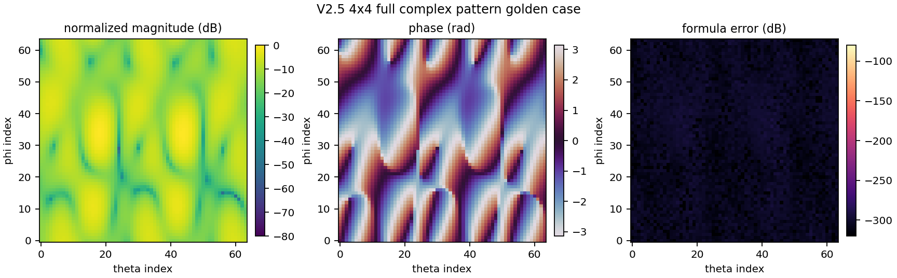

# V2.5 完整版本包

## 版本摘要

| 项目 | 内容 |
|---|---|
| 类型 | 控制器与完整方向图观察器的独立发布包 |
| 继承 | V2.4 数学控制器；不依赖 V2.4 目录或分支即可运行 |
| 主要变化 | 合并 4×4/1×4 轻量 CNN 控制器、INT8 golden 与零参数完整复方向图观察器 |
| 冻结结论 | 仿真和 FPGA 前算法证据完整；不代表板级、暗室 OTA 或实时部署验收 |
| 后续关系 | V2.6 固定到真实 HFSS 1×4 阵列；V2.7 进一步刻画其物理可达边界 |

本目录是 V2.5 唯一的版本边界。所有新增算法都在 `code/`；版本输入在 `input/`；
冻结结果在 `output/`。根目录的旧 JSON 和图片来自 `main`，只用于原论文复现，
不是 V2.5 结果。

V2.5 包含两个可独立审查、联合运行的阶段：

- `controller_training`：V2.4 数学版本的 4×4/1×4 轻量二维 CNN 控制器完整训练
  与发布证据，包括 8 个 checkpoint、五种子统计、测点预算和 INT8 golden。
- `full_pattern`：V2.5 零参数完整复场物理观察器、历史 JSON 兼容、64 个独立公式
  数值案例以及 CNN 控制器→权值→64×64 复方向图的组合验证。

两份发布 low-update checkpoint 只保存在 `output/controller_training/`；完整图代码
直接读取这唯一副本。V2.5 不包含 `algorithm_versions/v2.4/`，也不依赖切换分支、
祖先提交或外部文件才能运行。

`input/full_pattern/comparison_inputs.json` 中四个文本来源的 SHA-256 使用 UTF-8/LF
规范化口径，避免 Windows CRLF 与 Linux/Docker LF 对同一提交产生不同校验结果；
checkpoint 和 NPZ 仍按原始二进制字节校验。

V2.5 所需输入、checkpoint 和验收结果均在本版本目录内；旧主线批量数据与逐 epoch 图未纳入
当前精简分支，需要时可从历史分支恢复。

## 推荐查阅顺序

1. `output/full_pattern/V2.5组会讲解与答辩手册.md`：逐版数学与答辩材料。
2. `output/controller_training/报告.md`：稀疏测点、少样本和 INT8 控制器证据。
3. `output/full_pattern/报告.md`：完整方向图恢复、历史回放和组合关系。
4. 两个 `input/` 子目录与对应 `comparison_results.json`、`pictures/` 相互对照。
5. 两份 `KNOWN_LIMITATIONS.md`：仿真、选模和 FPGA 前边界。



上图同时给出幅度、相位和独立公式误差，是本版保留的代表性可视证据；其余冻结图片用于
V2.5 自包含发布验收，不作为版本间优劣图。

## 只验证、不覆盖

```powershell
python -X utf8 -B -m unittest discover -s algorithm_versions/v2.5/code -p "test_*.py" -v
python -X utf8 -B algorithm_versions/v2.5/code/export_v24_controller_bundle.py --check
python -X utf8 -B algorithm_versions/v2.5/code/export_v25_comparison_bundle.py --check
python -X utf8 -B algorithm_versions/v2.5/code/validate_v25_artifacts.py
python -X utf8 -B algorithm_versions/v2.5/code/run_v25_release_pipeline.py --dry-run
```
