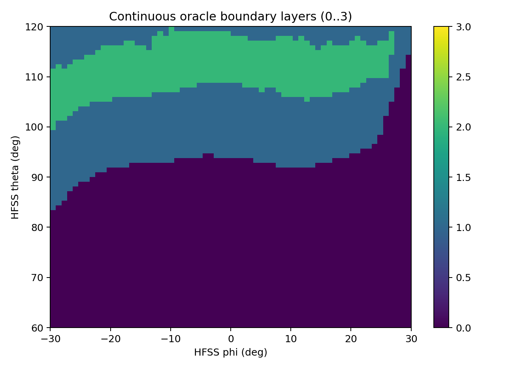
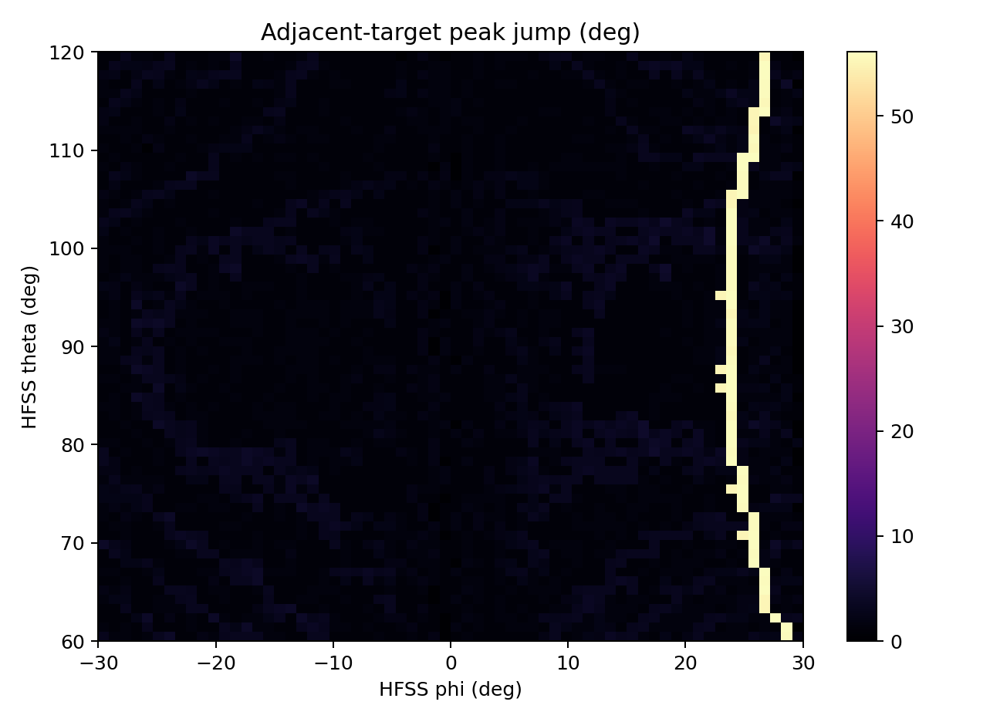

# V2.7：固定 1×4 阵列二维可控边界审计

## 版本摘要

| 项目 | 内容 |
|---|---|
| 类型 | 物理边界与停止门禁审计版，不是新 CNN 发布 |
| 继承 | V2.6 的 47 GHz、1×4 HFSS 阵列和控制接口 |
| 主要变化 | 用多起点物理 oracle、连续幅相与 INT8 搜索刻画 4,096 个目标方向 |
| 冻结结论 | 两项训练门禁均未达到，因此没有新 checkpoint；原始全局峰指向重复性门禁失败 |
| 后续关系 | 结论指向阵列物理自由度和栅瓣限制；V2.8 转入 4×4 amplitude-only 前向建模 |

V2.7 是从 `v2.6` 标签派生的特性审计版。它不改变 47 GHz、4 端口沿
HFSS `+Y` 排列、6.8 mm 间距的物理结构，也不重新求解 HFSS。规范电磁主干仍只读
引用 `../v2.6/data/hfss_reference_1x4/hfss_active_element_patterns_47ghz.npz`。

本版首先回答固定阵列在论文目标域 `theta=60..120 deg, phi=-30..30 deg` 上究竟能
控制哪些二维方向，再决定是否值得训练新 CNN。论文中的约 `2.8e-3` 验证损失只作为
“激励/误差到 64x64 复方向图”的前向预测参考，不进入逆向控制方法排名。

## 四层边界

每个方向在完整 1 度 HFSS 球面上计算：

1. `GAIN_REACHABLE`：目标点距全局峰不低于 -0.5 dB；
2. `POINTING_REACHABLE`：同时满足上项且主峰指向误差不超过 5 度；
3. `STRICT_UNAMBIGUOUS`：再要求目标点高于目标 8 度外最强峰至少 3 dB；
4. `ROBUST_UNAMBIGUOUS`：独立误差状态中严格条件通过率至少 95%。

`HPBW-aware` 强峰间隔会剔除与全局峰连通的 -3 dB 主瓣区域，只用于解释宽主瓣，
不得替代固定 3 dB/8 度门槛。

## 运行

从仓库根目录、使用项目现有 Python 环境运行：

```powershell
python -X utf8 -B algorithm_versions/v2.7/tests/run_tests.py
python -X utf8 -B algorithm_versions/v2.7/code/run_v27_pipeline.py --stage states
python -X utf8 -B algorithm_versions/v2.7/code/run_v27_pipeline.py --stage phase-map
python -X utf8 -B algorithm_versions/v2.7/code/run_v27_pipeline.py --stage oracle --workers 12
python -X utf8 -B algorithm_versions/v2.7/code/run_v27_pipeline.py --stage audit
python -X utf8 -B algorithm_versions/v2.7/code/run_v27_pipeline.py --stage state-oracle --workers 12
python -X utf8 -B algorithm_versions/v2.7/code/run_v27_pipeline.py --stage repeatability --workers 12
python -X utf8 -B algorithm_versions/v2.7/code/run_v27_pipeline.py --stage report
```

Oracle 阶段按单目标原子写入 `output/oracle_shards/`，中断后同一命令会跳过已验证
记录。首次优化为 32 个确定性起点、最多 300 步；失败或接近阈值的方向自动以独立
种子、64 起点、最多 600 步复核。只有 4,096 个唯一目标均收敛且无缺失时，报告才会
用连续幅相/INT8 地图做边界结论。

离线查询接口：

```python
from boundary_v27 import BoundaryIndex

index = BoundaryIndex.from_npz("algorithm_versions/v2.7/output/maps/boundary_maps.npz")
result = index.query_boundary((113.0, 0.0), "nominal/continuous_disk")
```

返回值固定包含四层边界、物理指标、鲁棒通过率、最近可达方向、连续跟踪标志和原因。
发布图中的 `state_class` 是明确的方法/状态标签，例如 `nominal/continuous_disk`、
`nominal/int8_disk`、`baseline/v2.6_zero_residual_int8`；未完成独立状态复核的方法会把
`robust_evaluated` 置为 false，而不是把未知结果伪装成稳健可达。
参数状态可用 `audit/mixed/v2.6_zero_residual_int8`、
`audit/failed_port/v2.6_zero_residual_int8` 等标签查询；这些地图由每个 16×16 分层
单元中的独立状态样本汇总后扩展到查询网格，并在报告中明确其采样分辨率。
V2.6 的 `calibrate()`、`beamform()` 和 15 通道部署输入没有改动。

## 训练门禁

仅当连续幅相 oracle 相对 V2.6 解析基线使 `POINTING_REACHABLE` 面积至少增加 2 个
百分点，或至少 5% 方向在目标功率约束下把固定 8 度强峰间隔提高 0.25 dB，才允许
生成 V2.7 checkpoint。否则本版以“二维边界特性版”发布，不制造无意义的新模型。

## 本次完整审计结论

- 三类名义 oracle 均完成 4,096 个唯一方向；连续幅相 oracle 的
  `POINTING_REACHABLE` 为 665/4,096，INT8 圆盘 oracle 为 671/4,096，但三类
  `STRICT_UNAMBIGUOUS` 均为 0。
- 连续幅相相对 V2.6 解析基线的指向可达面积只增加 1.9775 个百分点；固定 8 度强峰
  间隔改善至少 0.25 dB 的方向占 2.5635%。两项均低于训练门禁，因此没有生成新的
  V2.7 checkpoint。
- 83 个误差状态、每状态 256 个目标均已评估，共 21,248 个独立控制案例；每例保存
  V2.5、V2.6、phase-only 参考及 FP32/INT8 结果。
- 5% 独立 oracle 重算中，目标增益和强峰间隔重复性通过，但原始全局峰指向有
  31/205 个样本变化超过 1 度，最大变化 51.96 度。这是近等高空间峰之间的峰标签
  跳变，仍按原始验收口径记为失败，不用 HPBW-aware 指标替代。

因此 V2.7 的发布类型是“二维边界特性版”，最终机器验收状态为
`complete_with_failed_raw_pointing_repeatability_gate`。它完成了边界和敏感性测量，
但没有证明固定 1×4 阵列能够在整个二维目标域形成唯一、稳定的 3 dB 主峰。





这两张图分别保留“哪些方向可达”和“为何原始指向重复性失败”的空间信息；逐方法数值对比
仍以表格和 `V2.7_SUMMARY.json` 为准。逐样本审计保留紧凑 `control_cases.npz`，同内容的
大型 CSV 不纳入当前精简分支。

## 结果解读：优化机制、论文关系与应用距离

### 1. V2.7 当前到底在优化什么

V2.7 不是一次新的 CNN 训练发布，而是对 V2.6 控制链和固定 HFSS 阵列进行物理边界审计。
当前真正产生优化结果的是物理 oracle、解析初值和离散码字搜索，CNN 只保留为后续可训练
的部署接口。

对每个目标 `(theta, phi)`，流程如下：

1. 从 HFSS 四个端口的嵌入式复方向图得到目标方向响应
   `H_theta(theta,phi,n)` 和 `H_phi(theta,phi,n)`，直接使用
   `E = sum_n H_n w_n`，不再用理想导向矢量拟合，也不重复乘 S 参数耦合矩阵。
2. 先做 phase-only 参考。每个端口幅度固定为 1，通过目标响应 Gram 矩阵的坐标相位
   上升，在 32 个确定性起点中选目标功率最大的相位解。
3. 再做连续幅相优化。四个复权值写成幅度 `[0,1]` 与相位 `[-pi,pi]` 八个变量，
   用 SLSQP 在目标功率不低于 phase-only 参考 `P_ref - 0.5 dB` 的约束下，压低目标
   8 度排除区外的最大峰。优化采用 12 阶 log-sum-exp 平滑最大峰，并用 active-set
   交换把完整球面上新出现的强峰逐轮加入；失败或接近阈值的方向再用 64 起点、600 步
   独立复核。
4. 最后做 INT8 圆盘优化。连续解先映射到 `[-127,127]` 整数 I/Q，随后逐端口在
   `di,dq in {-2,-1,0,1,2}` 的邻域内坐标搜索，保持 `qI^2+qQ^2 <= 127^2` 和
   目标功率约束，直到目标函数不再改善。
5. 对每个解在完整 1 度 HFSS 球面上计算目标功率、全局峰、指向误差、8 度外强峰
   间隔、HPBW-aware 诊断、ETheta/EPhi 功率和主导极化比，再按四层边界分类。

因此这里的“优化”主要是物理约束下的权值搜索，而不是神经网络把损失训练到更低。
V2.7 的训练门禁要求连续幅相 oracle 相对 V2.6 解析基线增加至少 2 个百分点的指向
可达面积，或让至少 5% 的方向获得至少 0.25 dB 的强峰间隔改善；两项都没有达到，
所以没有生成新的 V2.7 checkpoint。

### 2. 优化是否充分

对于“判断这副固定阵列的物理边界”这一目的，优化强度已经足够：4,096 个目标全部
收敛并有记录，1,068 个临界/失败方向使用了更高起点数和步数复核，另有 205 个点用
独立种子重复计算。目标增益重复误差最大约 `6e-9 dB`，严格强峰间隔重复误差最大
约 `0.017 dB`，说明功率和间隔数值是稳定的。

但它不能被解释为数学意义上的全局最优证明。SLSQP、active-set 和有限起点仍可能
漏掉其他局部解；同时，HFSS 数据是一个固定频率的保存场，未包含真实馈电链非线性、
温漂和 OTA 测量误差。因此，V2.7 足以支持“当前阵列在给定指标下受到物理限制”的
工程结论，却不足以声称“所有可能算法都不可能改善”。

205 点复核还暴露了一个重要的指标问题：31 点的原始全局峰指向变化超过 1 度，最大
变化约 51.96 度，而目标增益和严格强峰间隔仍高度重复。这些点是两个近等高空间峰在
`argmax` 标签上的跳变，不是功率优化随机失效。报告保留了该失败，没有用 HPBW-aware
或宽松的峰值匹配替换预先约定的原始指向门槛。

### 3. 与论文设想一致的部分

论文在研究目标和第四章中强调复数 I/Q 表示、幅度与相位误差注入、复数损失，以及用
轻量编码器-解码器学习阵列激励到复方向图的映射；论文报告的最佳验证损失约为
`2.8e-3`。第五章还把复数乘法、IQ 相位旋转、幅相加权和 DAC 输出拆成适合 FPGA 的
硬件模块。V2.7 与这些设想保持以下一致：

- 继续使用复数场、I/Q 权值和 ETheta/EPhi 两个极化分量，而不是把相位强行当作普通
  实数回归；
- 用幅度/相位误差、测量 SNR、全局相位和阵元失效生成状态，符合论文对非理想阵列
  与通道扰动的关注；
- 保留解析物理模型作为主干，把复乘、圆盘投影、health mask 和 INT8 码字放在主机或
  未来 FPGA 的 PS/外围逻辑侧，CNN 只处理可固定形状的残差；
- 输出仍是可直接进入 IQ/DAC 链的复权值，且每个 INT8 码字严格满足整数圆盘约束。

### 4. 与论文设想不一致的部分

最根本的差异是任务方向相反。论文主要证明的是
“阵元激励/误差 -> 64x64 复方向图”的前向预测；V2.7 研究的是
“目标方向 + 校准状态 -> 四个复权值”的逆向控制，并进一步判断目标是否可达。论文
中的 `2.8e-3` 是方向图预测误差，不能换算成 V2.7 的指向误差、旁瓣间隔或实际增益
保证。

此外，论文使用的是理想化/仿真的均匀阵列方向图数据和通用 FPGA 资源验证；V2.7 锁定
的是 47 GHz、四端口沿 HFSS `+Y` 排列、间距 6.8 mm 的嵌入式实阵列场。论文没有给出
当前 HFSS 全球面上的 3 dB/8 度唯一主峰边界、失效端口鲁棒通过率或近等高峰跳变分析。
论文第五章完成的是 XC7A35T 上 IQ/DAC 等关键模块的 HDL/资源级验证，而 V2.7 尚未
执行 Vitis PTQ、XModel、VART、bitstream 或实板运行。因此“论文已完成 FPGA 模块”
与“V2.7 已完成神经网络 FPGA 部署”不能混为一谈。

### 5. 算法架构是否合理

架构方向是合理的，但当前证明的是“物理主干合理”，不是“学习器性能已经证明”。
V2.6/V2.7 的部署接口为 `[B,15,1,4] -> [B,2,1,4]`：输入包括解析初值、每端口
校准 I/Q、健康掩码、目标方向的 ETheta/EPhi 响应、端口位置、单位方向向量、包络和
校准置信度；CNN 设计为 1x3、宽度 16、3 个 depthwise residual block。DPU 核心仅保留
Conv2d、depthwise Conv2d、ReLU6 和残差加法，复杂复乘、幅度裁剪和 INT8 圆盘投影放在
PS 侧。这种分工避免让 CNN 重复学习 HFSS 已经知道的电磁规律，也有利于固定图和后续
Vitis 编译。

局限也很明确：只有 4 个阵元，独立空间自由度非常少；二维角度输入并不意味着二维
波束可控。当前 `d=6.8 mm` 在 47 GHz 约为 `1.07 lambda`，周期性/空间混叠会产生
强栅瓣；网络再复杂也不能从已有四个端口自由度中创造新的独立孔径。若把 CNN 直接
训练成“任何二维目标都可行”，会学到不可靠的标签或把不可达方向误报为成功。因此先
做 oracle 边界和失败原因，再决定是否训练，是比盲目扩大网络更合理的架构策略。

### 6. V2.7 结果体现出的结论

名义 64x64 网格的结果如下：

| 方法 | GAIN_REACHABLE | POINTING_REACHABLE | STRICT_UNAMBIGUOUS |
| --- | ---: | ---: | ---: |
| phase-only | 1742/4096 | 583/4096 | 0/4096 |
| continuous amplitude+phase | 1799/4096 | 665/4096 | 0/4096 |
| INT8 disk | 1800/4096 | 671/4096 | 0/4096 |

连续幅相相对 V2.6 解析基线的指向可达面积只增加 `1.9775` 个百分点，达到至少
`0.25 dB` 强峰间隔改善的方向只占 `2.5635%`。这说明幅相自由度在少数边界方向有
帮助，但不足以改变整体物理结论。INT8 相对连续解的名义地图甚至略多几个 pointing
样本，不能理解为量化改善了物理可达性，只能视为离散码字和峰值标签的局部差异。

83 个状态、每状态 256 个目标共 21,248 例中，V2.6 零残差 FP32 的中位目标功率
后悔值仅 `0.000055 dB`，INT8 为 `0.0218 dB`；V2.5 原始 15 mm 接口在 6.8 mm
HFSS 阵列上的中位后悔值约 `6.45 dB`，因此 V2.5 的劣化主要是几何契约失配，不是
简单的量化误差。另一方面，V2.6 的 p95 指向误差仍约 `57.9 度`，且严格可行样本为
0，说明目标功率能对准不等于全局唯一主瓣能对准。

综合而言，当前固定阵列更适合被定义为“有限方向、best-effort、带可行性标志的权值
控制器”，不适合宣称在整个二维域完成精确智能扫描。V2.7 因而是一个完成边界刻画的
特性版本，而不是性能已经达标的模型版本。

### 7. 距离实际应用还有多远

当前结果已经跨过了“算法逻辑和固定 HFSS 场的主机闭环”这一关，但距离可交付系统仍
有四层差距：

1. **模型层**：没有新的 V2.7 训练权重，尚未证明训练 CNN 能逼近连续 oracle；当前
   结果主要是解析控制器和物理 oracle 的能力上限。
2. **数据层**：只有固定 47 GHz HFSS 保存场，尚未用真实阵列测量校准馈电增益、相位、
   温漂、线缆和 DAC/PA 非线性，也没有 OTA 独立验证。
3. **部署层**：Vitis AI PTQ、XModel 导出、KV260/K26 编译、VART/PS 调度和时延/资源
   测量均未在 V2.7 执行；更没有 XC7A35T bitstream。电脑端仿真不能替代这些证明。
4. **系统层**：还需要把“可行/不可行、峰值歧义、校准不确定、阵元不足”的原因位接到
   上层扫描策略，并确定实际应用是否接受 best-effort 波束、较宽主瓣或降低旁瓣指标。

因此，若应用目标坚持“任意二维方向、唯一主峰、至少 3 dB 强峰间隔”，当前主要缺口
不是再训练几轮，而是固定 1x4 阵列的物理可达性。若应用允许把目标域缩小到已验证的
可达区域、使用主瓣跟踪/连续性指标并接受失败标志，V2.7 已经提供了一个可继续做
真实测量和硬件接口验证的起点。
